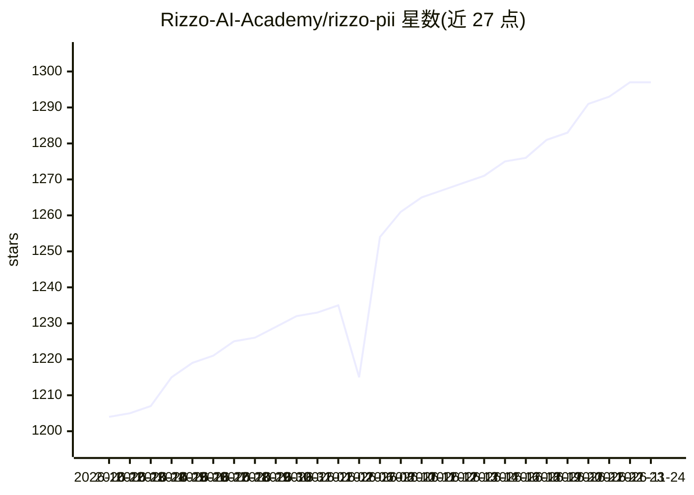

# Rizzo-AI-Academy/rizzo-pii

⭐ 1,297 · Python · MIT · 推送 2026-11-16 · [GitHub](https://github.com/Rizzo-AI-Academy/rizzo-pii) · [官网](https://rizzo-ai-academy.github.io/rizzo-pii/) · 组织维护

**为受 GDPR 约束的意大利法律从业者本地化名文档后再用云端 LLM**

本地优先的 PII 匿名化工具：基于约 0.3B 参数的 mmBERT/ModernBERT token 分类模型，检测 22 类个人数据，包括意大利法律标识符（codice fiscale、partita IVA、dati catastali）并支持 IBAN/Luhn/CF/PIVA 校验和验证。工作流为本地匿名化→占位符与本地可逆字典→发送占位文本给云端 LLM→本地还原真实值。模型在 CPU 上运行，内存占用约 0.5 GB，离线无需 API key；提供 Windows/macOS/Linux 桌面安装包，处理文本 PDF、扫描件与照片。

## 筛选速览

| 维度 | 判定 | 备注 |
|---|---|---|
| AI 角色 | `ai-native` | 本体是模型或模型工具 |
| 许可风险 | `permissive` | MIT |
| 部署形态 | `desktop` | 安装包/桌面程序 |
| 模型依赖 | — | README 未给出锁定关系 |
| 硬件要求 | `cpu-ok` | |
| 安装摩擦 | `low` | 无编译、无系统依赖或容器化 |
| 成熟度 | — | 结构信号不足 |

## 能力要点

- 22 类 PII 检测，含意大利法律标识符，微平均 F1 0.989
- 可逆匿名化：占位符+本地磁盘字典，云端不接触真实数据
- 约 0.3B 参数，CPU 运行，约 0.5 GB RAM，离线无 API key
- 正则补充第 23 类 URL 检测标签

## 适用场景

- 律所/会计师事务所将合同等敏感文档交给 ChatGPT/Claude/Gemini 前先行匿名化
- GDPR 数据最小化合规场景下避免真实个人数据出境
- 本地离线检测意大利文本中的个人标识符

## 场景标签

`文档解析` `目标检测` · 领域:知识与检索

## 证据(README 行号)

> L29: **`rizzo-pii:0.3B`** is a lightweight, CPU-friendly, **Italian-first** token-classification
> L35: 🔒 **anonymize locally** → 🏷️ **placeholder + reversible local dictionary** → ☁️ **frontier LLM** → 🔓 **restore loca
> L94: - **The data never leaves the device.** Detection and re-identification run locally on a CPU.

## 星数曲线

2026-10-22 1,204 → 2026-11-24 1,297（+93）

---
*卡片 v1 · prompt 1.4 · 生成 2026-11-23 · 置信度 high · 依据 README sha `020933d1e81d` · [字段定义](../../DATASET.md)*
