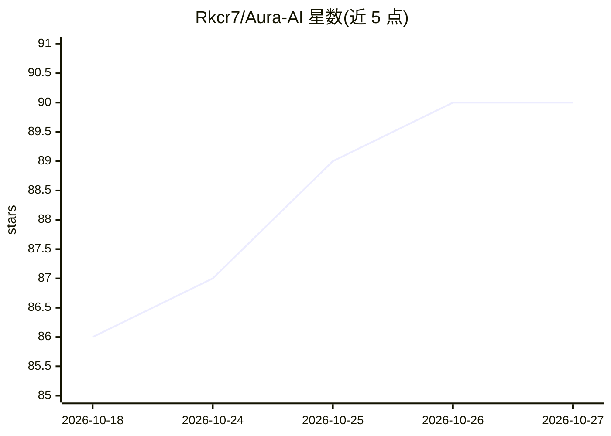

# Rkcr7/Aura-AI

⭐ 90 · JavaScript · MIT · 推送 2026-10-15 · [GitHub](https://github.com/Rkcr7/Aura-AI) · [官网](https://aura-ai-stealth.netlify.app/) · 个人维护

**屏幕隐形 AI 助手：面试/考试中实时监听、截图分析、隐蔽给答案**

运行在屏幕上的透明悬浮层应用：通过 Deepgram 实时语音转文字监听对话，调用 Groq、Cerebras、Gemini 等 LLM 生成实时回答，支持截图交给 Vision 模型分析题目并叠加显示解答。悬浮层通过 WDA_EXCLUDEFROMCAPTURE 从屏幕捕获中排除、可点击穿透、隐藏于任务栏，宣称对 Zoom/Teams/监考软件不可见。用户自带各服务商 API key 使用。Windows 10/11 为主要支持平台，macOS 移植在 macos 分支进行中、部分隐蔽行为受限。面向参加面试与考试的个人用户。

## 筛选速览

| 维度 | 判定 | 备注 |
|---|---|---|
| AI 角色 | `ai-native` | 本体是模型或模型工具 |
| 许可风险 | `permissive` | MIT |
| 部署形态 | `library` | 以包/库形式分发 |
| 模型依赖 | locked-api |  |
| 硬件要求 | — | 无带数字的原话,不猜 |
| 安装摩擦 | `low` | 无编译、无系统依赖或容器化 |
| 成熟度 | — | 结构信号不足 |

## 能力要点

- Deepgram 实时语音转文字 + 多 LLM（Cerebras/Groq/Gemini）生成回答
- Vision AI 截图分析，支持最多 4 张截图排队处理
- 悬浮层经 WDA_EXCLUDEFROMCAPTURE 排除于屏幕捕获，支持 40% 透明度与点击穿透
- Alt+Q/W/E 等全局热键即时切换主/副/视觉模型

## 适用场景

- 在线面试或考试期间实时获取 AI 提示与答案
- 截屏代码题或量化题并叠加显示 AI 解答
- 会议或直播中旁人不可见地查询信息

## 场景标签

`AI 助手` · 领域:对话与助手

## 证据(README 行号)

> L45: Aura sits on top of your screen as an **invisible overlay** during live interviews and exams. It **listens** to con
> L5: **An invisible AI overlay that lives on your screen — answers questions, solves problems, analyzes screenshots, and 

## 星数曲线

2026-10-18 86 → 2026-10-27 90（+4）

---
*卡片 v1 · prompt 1.4 · 生成 2026-10-23 · 置信度 high · 依据 README sha `08648b03a391` · [字段定义](../../DATASET.md)*
