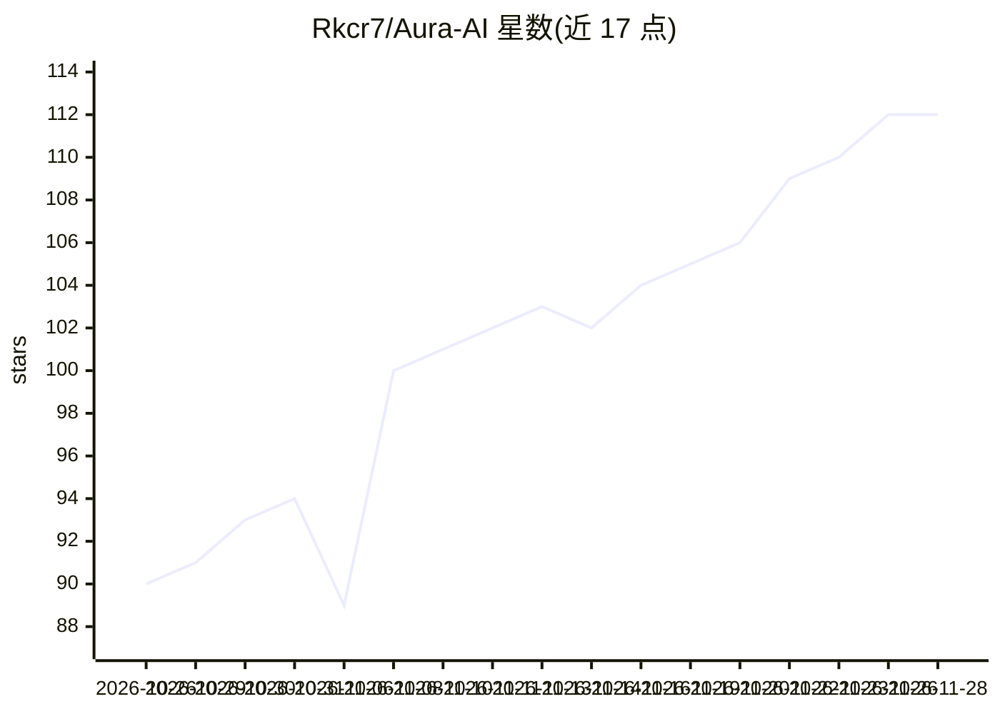

# Rkcr7/Aura-AI

⭐ 112 · JavaScript · MIT · 推送 2026-11-05 · [GitHub](https://github.com/Rkcr7/Aura-AI) · [官网](https://aura-ai-stealth.netlify.app/) · 个人维护

**面试考试场景的隐形屏幕悬浮 AI 助手，实时生成答案**

Aura 是一个运行在屏幕顶层的透明悬浮窗应用：通过 Deepgram 语音转写实时监听对话，调用 Groq/Cerebras/Gemini 等 LLM 生成回答，支持截图分析（Vision AI）与多截图队列，全部通过全局热键操作。主打隐形能力：窗口对屏幕录制与共享不可见、隐藏于任务栏。主要面向 Windows 10/11，macOS 分支功能尚在开发中。需要用户自带 API key，通过 run.bat 运行 Python 程序。

## 筛选速览

| 维度 | 判定 | 备注 |
|---|---|---|
| AI 角色 | `ai-native` | 本体是模型或模型工具 |
| 许可风险 | `permissive` | MIT |
| 部署形态 | `library` | 以包/库形式分发 |
| 模型依赖 | locked-api |  |
| 硬件要求 | — | 无带数字的原话,不猜 |
| 安装摩擦 | `low` | 无编译、无系统依赖或容器化 |
| 成熟度 | — | 结构信号不足 |

## 能力要点

- 屏幕捕获保护：经 WDA_EXCLUDEFROMCAPTURE 从录屏/共享中排除
- Deepgram 实时语音转写 + 多提供商 LLM 生成回答
- 截图 Vision AI：最多 4 张截图队列，Alt+S/Alt+P 处理
- 全局热键与模型即时切换（Alt+Q/W/E）

## 适用场景

- 面试中实时获取行为面/编程/系统设计题的回答提示
- 分析屏幕上的代码错误与算法题
- 按 Speed/Accuracy 标签在多模型间快速切换

## 场景标签

`AI 助手` · 领域:对话与助手

## 证据(README 行号)

> L5: **An invisible AI overlay that lives on your screen — answers questions, solves problems, analyzes screenshots, and 
> L55: Aura sits on top of your screen as an **invisible overlay** during live interviews and exams. It **listens** to con
> L79: The **Advanced Config** tab is the raw control panel. Enter your **Deepgram API key** (speech-to-text), then manage

## 星数曲线

2026-10-26 90 → 2026-11-28 112（+22）

---
*卡片 v1 · prompt 1.4 · 生成 2026-11-28 · 置信度 mid · 依据 README sha `cd02294343d7` · [字段定义](../../DATASET.md)*
