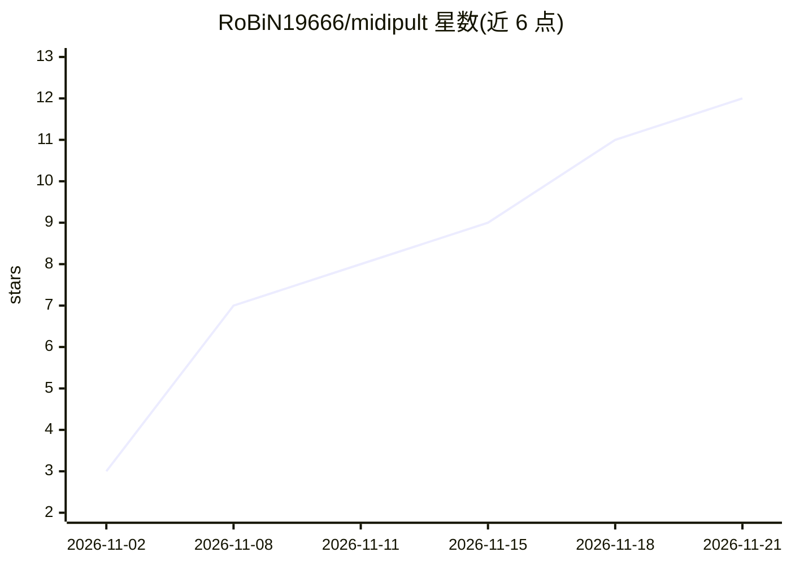

# RoBiN19666/midipult

⭐ 12 · Python · MIT · 推送 2026-11-20 · [GitHub](https://github.com/RoBiN19666/midipult) · 个人维护

**为已 root 的雅 station Midi 提供本地 Web 控制面板**

运行在雅 station Midi 音箱本机上的本地 Web 面板（lighttpd 8055 端口 + Python CGI），控制显示屏、24 LED 环、播放器/收音机、语音命令、VPN、蓝牙、定时场景、备份与系统诊断。AI 部分：通过 OpenAI/OpenRouter/DeepSeek 或自建 OpenAI 兼容服务器接入 LLM，支持多配置文件、聊天历史、system prompt 与语音朗读。要求 root + Entware，仅在特定固件版本上验证过；安装器可自动通过 opkg 安装 python3、lighttpd 等依赖。

## 筛选速览

| 维度 | 判定 | 备注 |
|---|---|---|
| AI 角色 | `ai-enhanced` | 去掉 AI 部分产品仍成立 |
| 许可风险 | `permissive` | MIT |
| 部署形态 | `None` |  |
| 模型依赖 | locked-api |  |
| 硬件要求 | — | 无带数字的原话,不猜 |
| 安装摩擦 | `low` | 无编译、无系统依赖或容器化 |
| 成熟度 | — | 结构信号不足 |

## 能力要点

- 通过 OpenAI/OpenRouter/DeepSeek API 的 LLM 聊天，支持多配置文件与语音输出
- 通过 Alice 语音命令激活/停用 LLM 配置文件
- LED 环控制、定时场景、sing-box VPN、备份与固件内更新
- 纯 HTML/CSS/JS 界面，无外部 CDN，轻量级 state-daemon

## 适用场景

- 无需使用云服务即可控制 root 后的雅 station Midi
- 通过 Alice 语音命令或面板向 LLM 提问
- 配置 LED 环、显示屏和定时场景
- 通过 VPN 订阅和 IPv6 开关管理音箱的网络

## 场景标签

`聊天机器人` · 领域:对话与助手

## 证据(README 行号)

> L13: Локальная веб-панель для рутованной **Яндекс Станции Миди**: дисплей, LED-кольцо,
> L88: ### Нейросеть

## 星数曲线

2026-11-02 3 → 2026-11-21 12（+9）

---
*卡片 v1 · prompt 1.4 · 生成 2026-11-18 · 置信度 high · 依据 README sha `6428d52f845c` · [字段定义](../../DATASET.md)*
