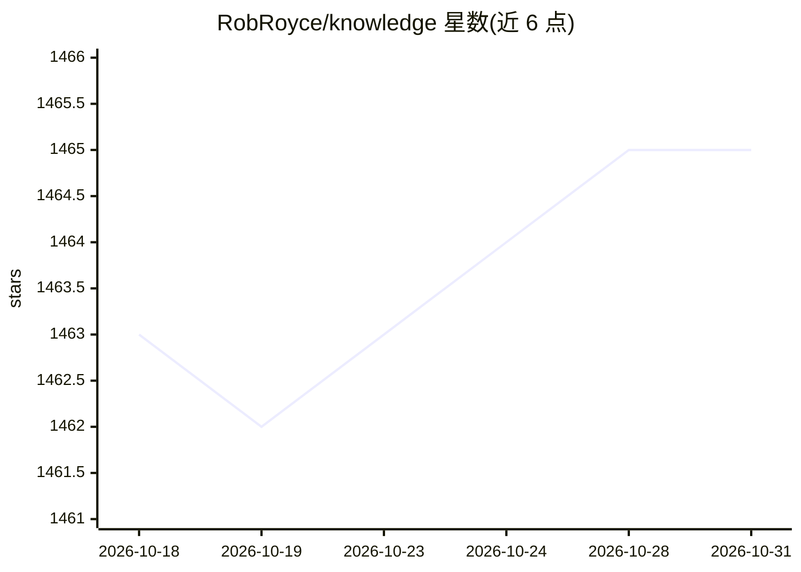

# RobRoyce/knowledge

⭐ 1,465 · TypeScript · Apache-2.0 · 推送 2026-10-08 · [GitHub](https://github.com/RobRoyce/knowledge) · 个人维护

**保存/搜索/探索网页文档并可用 LLM 对话的知识管理应用**

名为 Knowledge 的桌面知识管理工具：以 Inbox、Graph、Grid 等视图保存、搜索、访问和探索网站、文档与文件，构建知识图谱。支持基于大语言模型的 Chat 功能，可与 Projects 和 Sources 对话提问；内置 Chromium 浏览器，可右键总结网页、提取主题或转为 Notes。提供安装包下载、Chrome 扩展与从源码构建的开发文档。README 声明项目已停止开发，且软件不作为消费级产品、不提供任何保证。

## 筛选速览

| 维度 | 判定 | 备注 |
|---|---|---|
| AI 角色 | `ai-enhanced` | 去掉 AI 部分产品仍成立 |
| 许可风险 | `permissive` | Apache-2.0 |
| 部署形态 | `None` |  |
| 模型依赖 | — | README 未给出锁定关系 |
| 硬件要求 | — | 无带数字的原话,不猜 |
| 安装摩擦 | `low` | 无编译、无系统依赖或容器化 |
| 成熟度 | — | 结构信号不足 |

## 能力要点

- 基于 LLM 的 Chat 功能，可与项目与来源对话
- 内置 Chromium 浏览器，右键总结/提取主题/生成笔记
- Inbox、Graph、Grid 多种视图的知识管理
- 提供 Chrome 扩展

## 适用场景

- 把常用网站、文档和文件集中保存、搜索与探索
- 通过对话向自己的资料提问以加深理解
- 浏览网页时即时总结并沉淀为笔记

## 场景标签

`知识库管理` `知识图谱` `文档问答` · 领域:知识与检索

## 证据(README 行号)

> L4: Knowledge is a tool for saving, searching, accessing, exploring and chatting with all of your favorite websites, doc
> L10: Dive into a more interactive learning experience with Knowledge's new Chat feature! Engage in dynamic conversations

## 星数曲线

2026-10-18 1,463 → 2026-10-31 1,465（+2）

---
*卡片 v1 · prompt 1.4 · 生成 2026-10-21 · 置信度 mid · 依据 README sha `1fa97993d6aa` · [字段定义](../../DATASET.md)*
