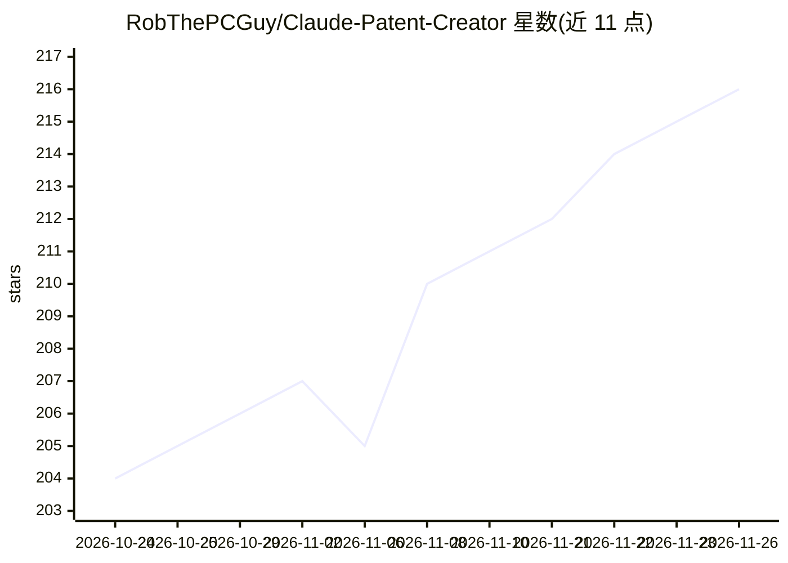

# RobThePCGuy/Claude-Patent-Creator

⭐ 216 · Python · MIT · 推送 2026-11-20 · [GitHub](https://github.com/RobThePCGuy/Claude-Patent-Creator) · [官网](https://github.com/RobThePCGuy/Claude-Patent-Creator) · 个人维护

**给专利申请人用的 AI 专利起草与检索系统（Claude Code 插件+桌面应用）**

面向非律师、非程序员的发明者，把专利流程封装为 MCP 服务器与 Claude Code 插件：用自然语言查询 MPEP/USC/CFR 规则并附引用，做现有技术检索（SerpApi/Google Patents、EPO OPS、BigQuery、USPTO ODP 等可选通道），按审查员视角做 35 USC 112 合规性与形式检查，生成专利风格附图（Graphviz），并通过引导式工作流从想法产出可交付律师审阅的申请草稿。另有免费的 Mac/Windows 桌面应用免终端运行整套系统，需 Claude 付费套餐或含 Codex 的 ChatGPT 套餐。工具明确声明不代为提交申请、不提供法律意见。

## 筛选速览

| 维度 | 判定 | 备注 |
|---|---|---|
| AI 角色 | `ai-native` | 本体是模型或模型工具 |
| 许可风险 | `permissive` | MIT |
| 部署形态 | `desktop` | 安装包/桌面程序 |
| 模型依赖 | locked-api |  |
| 硬件要求 | — | 无带数字的原话,不猜 |
| 安装摩擦 | `medium` | 含编译或系统依赖之一 |
| 成熟度 | `idea` | |

## 能力要点

- 混合 RAG 检索 MPEP/USC/CFR 规则并返回带出处的原文摘录
- 多通道现有技术检索：SerpApi(Google Patents)、EPO OPS、BigQuery、USPTO ODP
- 35 USC 112 合规检查并报告未运行的检查项
- 提供 Mac/Windows 桌面应用 Patent Creator Studio 免终端使用

## 适用场景

- 起草专利前检索现有技术判断新颖性
- 让 AI 按审查员视角检查权利要求措辞与格式问题
- 根据发明描述生成专利附图和流程图
- 查询专利规则条文并获取引用出处

## 场景标签

`RAG` `文档问答` `科研工具` · 领域:知识与检索

## 证据(README 行号)

> L9: **An AI-powered patent creation and analysis system for Claude Code.**
> L17: - **Ask patent-rule questions in plain English.** "Do my claims have to be numbered?" "How long can the abstract be
> L21: - **Go from "here is my idea" to a reviewable draft application.** A guided workflow takes your description (or eve

## 星数曲线

2026-10-24 204 → 2026-11-26 216（+12）

---
*卡片 v1 · prompt 1.4 · 生成 2026-11-25 · 置信度 mid · 依据 README sha `8d070074988b` · [字段定义](../../DATASET.md)*
