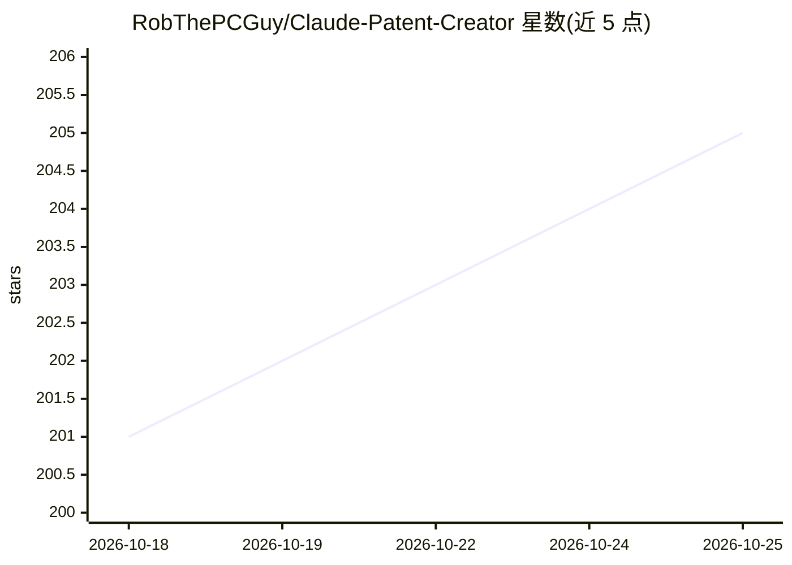

# RobThePCGuy/Claude-Patent-Creator

⭐ 205 · Python · MIT · 推送 2026-10-06 · [GitHub](https://github.com/RobThePCGuy/Claude-Patent-Creator) · [官网](https://github.com/RobThePCGuy/Claude-Patent-Creator) · 个人维护

**面向 Claude Code 的美国专利起草与检索系统（MCP 服务器+插件）**

以 MCP 服务器（20+ 工具）与 Claude Code 插件两种形态运行的专利创建与分析系统。功能包括：对 MPEP/35 USC/37 CFR 的混合 RAG 检索（FAISS 向量+BM25 词法+交叉编码器重排）、经 BigQuery/SerpApi/USPTO API 检索 1 亿+专利做现有技术搜索、35 USC 112 条款合规检查、Graphviz 生成专利附图，以及从描述到可审阅草稿的引导式工作流。安装向导自动下载约 500MB 官方 PDF 并构建索引，检测 NVIDIA GPU/Apple Silicon/CPU 并切换对应 PyTorch。明确声明不代为提交、不提供法律意见。

## 筛选速览

| 维度 | 判定 | 备注 |
|---|---|---|
| AI 角色 | `ai-native` | 本体是模型或模型工具 |
| 许可风险 | `permissive` | MIT |
| 部署形态 | `desktop` | 安装包/桌面程序 |
| 模型依赖 | locked-api |  |
| 硬件要求 | `cpu-ok` | |
| 安装摩擦 | `medium` | 含编译或系统依赖之一 |
| 成熟度 | — | 结构信号不足 |

## 能力要点

- MPEP/USC/CFR 混合 RAG 检索（FAISS+BM25+交叉编码器重排）
- BigQuery/SerpApi/USPTO API 多通道检索 1 亿+专利做现有技术搜索
- 35 USC 112(a)/(b) 合规检查与整包一致性检查
- Graphviz 生成专利风格框图与流程图

## 适用场景

- 提交前检索 1 亿+现有专利判断想法是否新颖
- 让 AI 按审查员口径检查权利要求书与说明书草稿
- 从想法描述生成可交专利代理人审阅的完整申请草稿包

## 场景标签

`RAG` `AI 写作` `科研工具` · 领域:内容生成

## 证据(README 行号)

> L9: **An AI-powered patent creation and analysis system for Claude Code.**
> L101: **MCP Server** is the engine. It exposes 20+ tools that any MCP-compatible client (Claude Code, Claude Desktop, et
> L105: Under the hood, patent regulation search uses a hybrid approach: FAISS vector search finds semantically similar co

## 星数曲线

2026-10-18 201 → 2026-10-25 205（+4）

---
*卡片 v1 · prompt 1.4 · 生成 2026-10-22 · 置信度 high · 依据 README sha `dfd43974f13e` · [字段定义](../../DATASET.md)*
