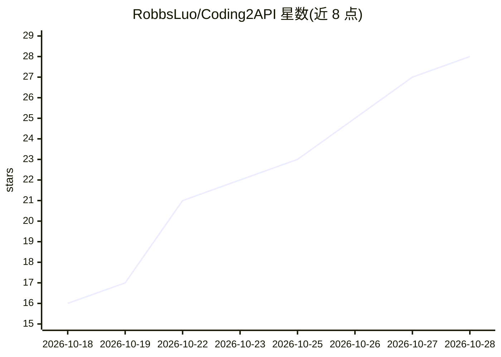

# RobbsLuo/Coding2API

⭐ 28 · Python · MIT · 推送 2026-10-28 · [GitHub](https://github.com/RobbsLuo/Coding2API) · [官网](https://github.com/RobbsLuo/Coding2API/pkgs/container/coding2api) · 个人维护 · 中文 README

**把八个编程助手上游封装为 OpenAI 兼容 API 的网关**

自部署的 FastAPI 网关：将 CodeBuddy（国内+国际）、TRAE SOLO、OpenCode Zen、Kilo、Qoder、华为云 CodeArts、OfficeAce 八个上游渠道逆向封装为 OpenAI / Responses / Anthropic 兼容 API。提供公共凭证池（加密入库）、按健康度/到期额度的统一调度与会话粘性、模型列表按可用凭证加载、额度探测与每日签到、成长中心自动化（CodeBuddy）、三角色（admin/operator/viewer）管理台与按人用量统计。逆向接口，README 声明仅供学习研究、未做安全审计，公网部署需反向代理+鉴权+IP 白名单。

## 筛选速览

| 维度 | 判定 | 备注 |
|---|---|---|
| AI 角色 | `ai-ecosystem` | LLM/agent 周边工具 |
| 许可风险 | `permissive` | MIT |
| 部署形态 | `self-host` | docker 或自建部署 |
| 模型依赖 | — | README 未给出锁定关系 |
| 硬件要求 | — | 无带数字的原话,不猜 |
| 安装摩擦 | `low` | 无编译、无系统依赖或容器化 |
| 成熟度 | — | 结构信号不足 |

## 能力要点

- OpenAI / Responses（Codex CLI）/ Anthropic Messages（Claude Code）三种出口协议
- 公共凭证池：健康度调度、到期额度优先、会话粘同一凭证、模型级限流冷却
- 模型列表按凭证加载，只列可用渠道的模型
- 三角色管理台、审计日志、脱敏用量统计与上游状态聚合

## 适用场景

- 把多个编程助手账号聚合成统一 OpenAI 兼容端点供团队共用
- 在 Codex CLI 或 Claude Code 中接入自建网关调用多渠道模型
- 按人/渠道/模型统计用量并估算成本

## 场景标签

`模型网关` · 领域:Agent 开发

## 证据(README 行号)

> L3: 八个上游——**CodeBuddy**（国内 + 国际）、**TRAE SOLO**、**OpenCode Zen**、**Kilo**、**Qoder**、**CodeArts**、**OfficeAce**——封装成 OpenA
> L10: - **OpenAI 兼容出口**：`/v1/chat/completions`（流式 / 非流式）、`/v1/responses`（Codex CLI）、`/v1/messages`（Claude Code）、`/v1/mode

## 星数曲线

2026-10-18 16 → 2026-10-28 28（+12）

---
*卡片 v1 · prompt 1.4 · 生成 2026-10-27 · 置信度 mid · 依据 README sha `006d9fc88837` · [字段定义](../../DATASET.md)*
