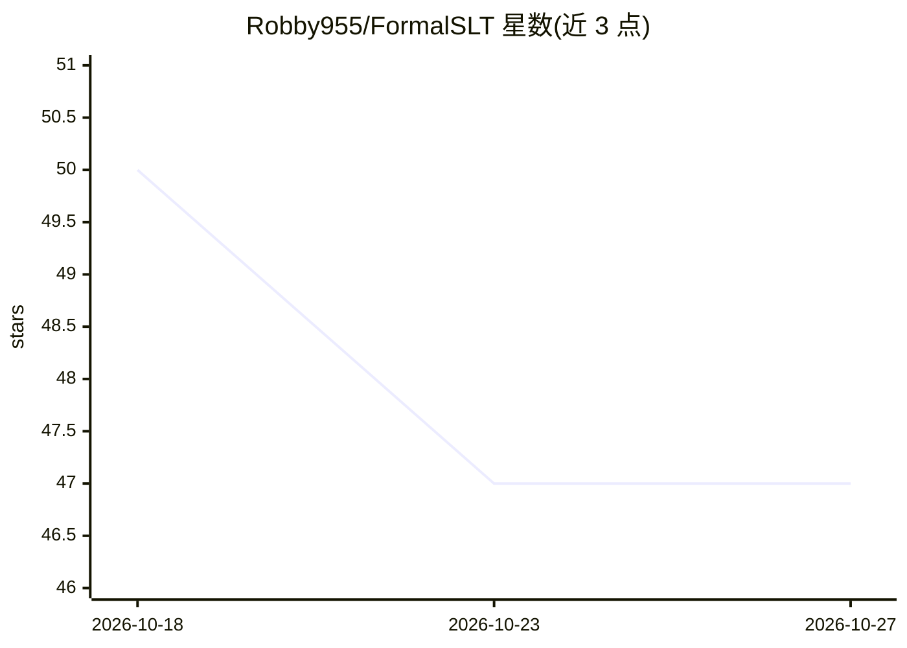

# Robby955/FormalSLT

⭐ 47 · Lean · MIT · 推送 2026-09-04 · [GitHub](https://github.com/Robby955/FormalSLT) · [官网](https://robby955.github.io/FormalSLT/) · 个人维护

**Lean 4 形式化统计学习理论库：机器可检验的泛化界与置信序列**

基于 Lean 4 与 Mathlib 的数学库，将统计学习理论核心结果形式化为机器可检验证明：VC 维与 Sauer-Shelah 界、Rademacher 对称化与收缩、度量熵与 chaining、anytime PAC-Bayes 与经验 Bernstein 界、置信序列与 e-过程，以及自适应轨迹与平稳/马尔可夫风险控制，并附 24 状态受控队列等端到端算例。面向形式化方法与学习理论研究者，通过 Lake 以 git 依赖引入（v0.2.0，需 Lean 4.32.2/Mathlib 4.32.2）。README 明确声明其不声称对 ML 系统做端到端验证，部分结果非 optional-stopping 定理。

## 筛选速览

| 维度 | 判定 | 备注 |
|---|---|---|
| AI 角色 | `ai-knowledge` | 知识聚合/清单类 |
| 许可风险 | `permissive` | MIT |
| 部署形态 | `None` |  |
| 模型依赖 | — | README 未给出锁定关系 |
| 硬件要求 | — | 无带数字的原话,不猜 |
| 安装摩擦 | `low` | 无编译、无系统依赖或容器化 |
| 成熟度 | — | 结构信号不足 |

## 能力要点

- VC/Rademacher/chaining 经典学习理论的形式化证明
- anytime PAC-Bayes 与经验 Bernstein 的样本量一致界（n≥2）
- e-过程、置信序列与自适应轨迹/马尔可夫风险的顺序推断层
- 附可执行 checker、Lean receipt 与 24 状态受控队列算例

## 适用场景

- 为学习理论研究提供机器可检验的定理基础并扩展现有结果
- 在可信顺序推断（置信序列/e-过程）研究中复用已验证引理
- 在 Lean 项目中引入 PAC-Bayes、VC、chaining 等主题模块做下游形式化

## 场景标签

`科研工具` · 领域:学习与行业

## 证据(README 行号)

> L10: FormalSLT is a Lean 4 library for statistical learning theory and modern
> L13: It develops reusable results in VC and Rademacher theory, metric entropy and
> L14: chaining, PAC-Bayes bounds, confidence sequences and e-processes, and learning

## 星数曲线

2026-10-18 50 → 2026-10-27 47（-3）

---
*卡片 v1 · prompt 1.4 · 生成 2026-10-25 · 置信度 high · 依据 README sha `62a52950bd91` · [字段定义](../../DATASET.md)*
