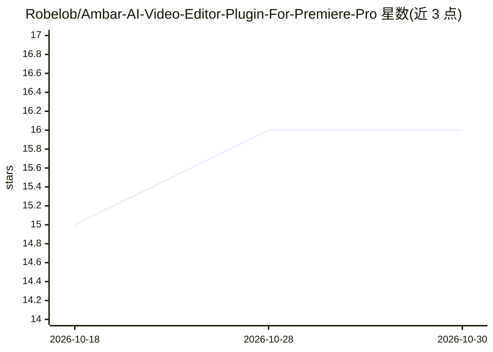

# Robelob/Ambar-AI-Video-Editor-Plugin-For-Premiere-Pro

⭐ 16 · JavaScript · 推送 2026-05-21 · [GitHub](https://github.com/Robelob/Ambar-AI-Video-Editor-Plugin-For-Premiere-Pro) · 个人维护

**Premiere Pro AI 插件：自动剪辑口播视频并加字幕**

Ambar 是 Premiere Pro 的 UXP+CEP 混合插件，面向口播/vlog 剪辑流程：三层音频管线（RMS 静音检测→Whisper 转录→LLM 编辑决策）完成去静音剪裁，另提供 B-roll 智能匹配（视觉模型分类+LLM 匹配字幕）、词级 SRT 字幕生成与素材箱自动归类。文本 LLM 支持 Ollama 本地、Gemini、OpenAI、Anthropic、Groq 等；转录支持 Groq/OpenAI/本地 whisper.cpp；视觉分类需本地 Ollama 多模态模型。不上传完整音视频，仅发送约 2KB 转录文本。剪辑采用标记预览+两步提交的非破坏流程，依赖隐藏 CEP 桥执行时间线裁剪操作。已知限制：切点交叉淡化需手动、撤销不批量、B-roll 与整理面板必须本地 Ollama。

## 筛选速览

| 维度 | 判定 | 备注 |
|---|---|---|
| AI 角色 | `ai-native` | 本体是模型或模型工具 |
| 许可风险 | `none` | — |
| 部署形态 | `None` |  |
| 模型依赖 | local-ok | 支持本地模型 |
| 硬件要求 | — | 无带数字的原话,不猜 |
| 安装摩擦 | `low` | 无编译、无系统依赖或容器化 |
| 成熟度 | — | 结构信号不足 |

## 能力要点

- 三层音频管线：RMS 静音检测→Whisper 转录→LLM 编辑决策
- B-roll 视觉分类与按字幕匹配放置到 V2 轨
- 词级 SRT 字幕或 .mogrt 模板，6 种内置样式
- 不上传完整音视频，仅发送约 2KB 转录文本

## 适用场景

- 自动去除口播视频中的静音与重复片段
- 让 AI 根据台词建议并放置 B-roll 画面
- 自动生成词级时间戳字幕
- 用视觉模型自动归类项目素材箱

## 场景标签

`图像视频处理` · 领域:感知与多模态

## 证据(README 行号)

> L3: Ambar is a Premiere Pro UXP + CEP hybrid plugin that uses AI to automatically edit talking-head vlogs: detecting and
> L9: |**Edit**|Three-layer audio pipeline: RMS silence detection → Whisper transcription → LLM editorial decisions. Place

## 星数曲线

2026-10-18 15 → 2026-10-30 16（+1）

---
*卡片 v1 · prompt 1.4 · 生成 2026-10-30 · 置信度 high · 依据 README sha `25e5dc2aa978` · [字段定义](../../DATASET.md)*
