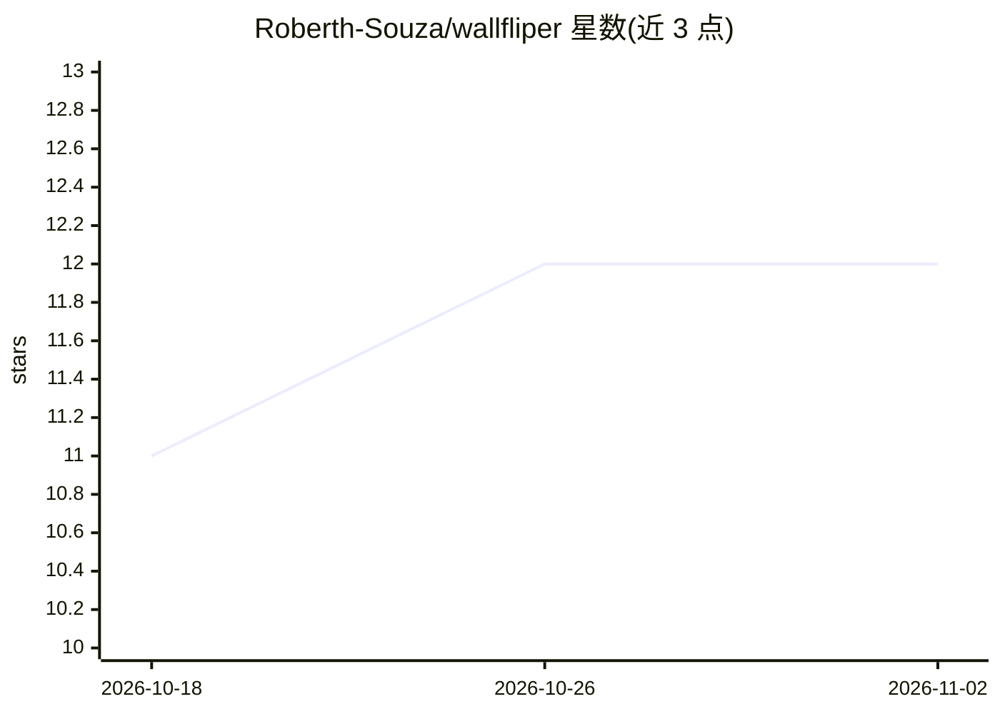

# Roberth-Souza/wallfliper

⭐ 12 · Python · GPL-3.0 · 推送 2026-10-06 · [GitHub](https://github.com/Roberth-Souza/wallfliper) · 个人维护

**Wayland 桌面的极简键盘操作壁纸选择器（图片/视频）**

基于 wlr-layer-shell 的 Rofi/yazi 风格壁纸选择器，用 PySide6/QML 绘制无边框覆盖层，静态壁纸委托 swww、循环视频壁纸委托 mpvpaper 渲染。面向 Hyprland、Sway、river、Wayfire、niri 等 wlroots 系合成器用户；KDE Plasma、GNOME、X11、Windows 不支持。提供过滤/颜色筛选/试听/随机/布局切换等键盘操作，登录时可通过 --restore 恢复壁纸，并能触发 matugen/wallust/pywal 等重新生成系统配色。从源码运行，需系统安装 PySide6 与 layer-shell-qt。代码主要由 Claude Code 等 AI 工具辅助编写。

## 筛选速览

| 维度 | 判定 | 备注 |
|---|---|---|
| AI 角色 | `ai-enhanced` | 去掉 AI 部分产品仍成立 |
| 许可风险 | `viral` | GPL-3.0 |
| 部署形态 | `library` | 以包/库形式分发 |
| 模型依赖 | — | README 未给出锁定关系 |
| 硬件要求 | — | 无带数字的原话,不猜 |
| 安装摩擦 | `medium` | 含编译或系统依赖之一 |
| 成熟度 | — | 结构信号不足 |

## 能力要点

- 静态图片（swww）与循环视频（mpvpaper）壁纸，含视频缩略图实时预览
- 键盘优先操作：过滤、颜色筛选、试听模式、随机选择、布局切换
- 登录时 --restore 恢复上次的壁纸（含视频壁纸）
- 应用壁纸后通知 matugen/wallust/pywal 等重新生成系统配色

## 适用场景

- 在 wlroots 系合成器上用键盘快速切换图片或视频壁纸
- 换壁纸后自动重新生成系统配色方案
- 重启登录后自动恢复之前的视频壁纸

## 场景标签

 · 领域:桌面/Linux 工具

## 证据(README 行号)

> L38: Honestly? I just wanted to give Claude Code a try, and ended up enjoying it a little too much.
> L40: Wallfliper was built mostly **"low-code"** — most of the codebase was written with the help of AI tooling like **Cl
> L3: **A minimalist, Rofi/yazi-style wallpaper selector for Wayland.**

## 星数曲线

2026-10-18 11 → 2026-11-02 12（+1）

---
*卡片 v1 · prompt 1.4 · 生成 2026-11-01 · 置信度 low · 依据 README sha `f728b71de366` · [字段定义](../../DATASET.md)*
