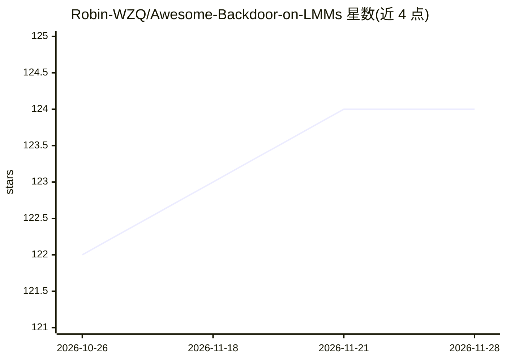

# Robin-WZQ/Awesome-Backdoor-on-LMMs

⭐ 124 · 推送 2026-11-23 · [GitHub](https://github.com/Robin-WZQ/Awesome-Backdoor-on-LMMs) · [官网](https://www.techrxiv.org/doi/full/10.36227/techrxiv.176618816.64264497/v3) · 组织维护 · 中文 README

**面向研究者的 LMM 后门攻击与防御论文策展清单**

与作者综述论文配套的论文收集清单，按四类大型多模态模型组织：视觉语言预训练模型、文本条件扩散模型等，每类下分攻击与防御两个子表。条目含时间、标题、发表会议、论文链接与代码链接。提供目录导航，接受社区 PR 补充条目，联系方式为中科院计算所邮箱。清单本身不含可运行的工具代码，条目按时间排序持续更新。

## 筛选速览

| 维度 | 判定 | 备注 |
|---|---|---|
| AI 角色 | `ai-knowledge` | 知识聚合/清单类 |
| 许可风险 | `none` | — |
| 部署形态 | `None` |  |
| 模型依赖 | — | README 未给出锁定关系 |
| 硬件要求 | — | 无带数字的原话,不猜 |
| 安装摩擦 | `low` | 无编译、无系统依赖或容器化 |
| 成熟度 | — | 结构信号不足 |

## 能力要点

- 按 VLP / TDM / VLM / Agents 四类模型组织条目
- 每类分 Backdoor Attack 与 Backdoor Defense 两个子表
- 条目含发表会议（CVPR/NeurIPS/ICML 等）与论文、代码链接
- 配套作者的综述论文，接受社区 PR 补充

## 适用场景

- 调研多模态模型后门攻击与防御的研究进展
- 查找某篇后门攻击/防御论文的代码实现
- 在开展安全性研究前了解已有工作分布

## 场景标签

`精选清单` · 领域:学习与行业

## 证据(README 行号)

> L3:  Curated list of backdoor attacks and defenses on Large Multimodal Models (LMMs), aligned with our work: Backdoor At
> L24: |Time|Title|Venue|Paper|Code|

## 星数曲线

2026-10-26 122 → 2026-11-28 124（+2）

---
*卡片 v1 · prompt 1.4 · 生成 2026-11-28 · 置信度 high · 依据 README sha `65db9426ded9` · [字段定义](../../DATASET.md)*
