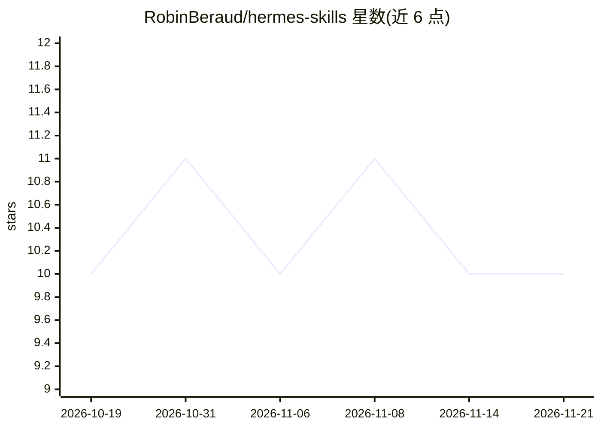

# RobinBeraud/hermes-skills

⭐ 10 · Python · 推送 2026-11-20 · [GitHub](https://github.com/RobinBeraud/hermes-skills) · 个人维护

**为 Hermes Agent 提供 29 个即装即用技能的开源库**

面向 Nous Research 的 Hermes Agent 的技能合集：技能以 Markdown（SKILL.md）形式提供上下文知识与可复用代码模式，放入 ~/.hermes/skills/ 目录即可被 agent 使用。覆盖金融行情（FMP）、网页抓取（Firecrawl）、SEO、WordPress、营销、创作者工具、运维审计等类别，另含 20 个 agent 角色的 AI Workforce。可通过 hermes skills 命令带安全扫描安装，新技能每日增加，通过 GitHub Actions 自动发布到 Dev.to。MIT 许可。

## 筛选速览

| 维度 | 判定 | 备注 |
|---|---|---|
| AI 角色 | `ai-knowledge` | 知识聚合/清单类 |
| 许可风险 | `none` | — |
| 部署形态 | `library` | 以包/库形式分发 |
| 模型依赖 | — | README 未给出锁定关系 |
| 硬件要求 | — | 无带数字的原话,不猜 |
| 安装摩擦 | `low` | 无编译、无系统依赖或容器化 |
| 成熟度 | — | 结构信号不足 |

## 能力要点

- 29 个技能覆盖金融、网页、营销、创作者、运维等场景
- hermes skills install/inspect 一条命令安装，带安全扫描与确认
- SKILL.md 放入 ~/.hermes/skills/ 即被 agent 识别
- 含 20 个 agent 角色的 AI Workforce，其中 13 个附测试过的脚本

## 适用场景

- 让 Hermes Agent 查询股票行情并生成基本面报告
- 抓取网页并转成 Markdown 或结构化 JSON
- 用技能审计 docker-compose、扫描泄露的密钥
- 为内容创作者生成日历、脚本与回复草稿

## 场景标签

`网页抓取` `金融量化` · 领域:效率与自动化

## 证据(README 行号)

> L4:  Open-source skills library for Hermes AI Agent — plug-and-play integrations for finance, web, marketing and more.
> L28: Skills are Markdown files that give Hermes contextual knowledge and reusable code patterns to interact with externa
> L30: ## Available Skills

## 星数曲线

2026-10-19 10 → 2026-11-21 10（+0）

---
*卡片 v1 · prompt 1.4 · 生成 2026-11-20 · 置信度 mid · 依据 README sha `ea4da08c4e92` · [字段定义](../../DATASET.md)*
