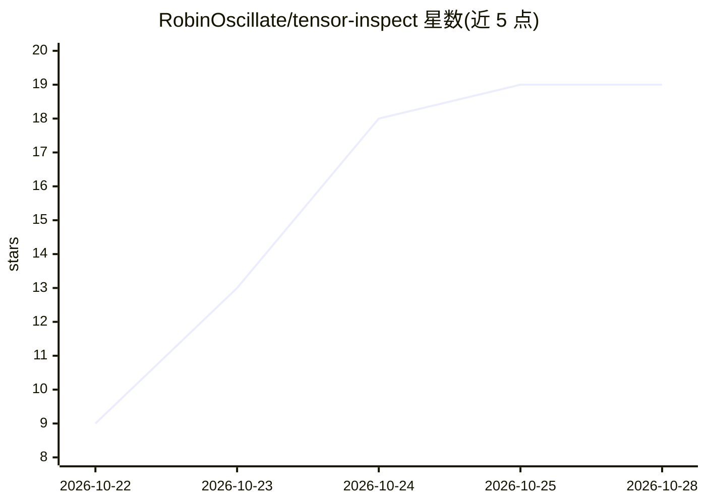

# RobinOscillate/tensor-inspect

⭐ 19 · C# · MIT · 推送 2026-10-18 · [GitHub](https://github.com/RobinOscillate/tensor-inspect) · 个人维护

**Windows 桌面工具：浏览与 diff GGUF/safetensors 模型的张量结构**

面向 Windows 10/11 x64 的张量检查器，读取 GGUF 与 safetensors 文件：以可排序表格列出全部张量的名称、shape、dtype 与量化类型，支持搜索过滤、两个 checkpoint 的差异对比（新增/移除/resized 张量）、架构层摘要与量化报告（按 F16/Q4_K 等类型统计字节）、CSV 导出。以 100 MB 自包含单文件 exe 分发，免安装、离线运行，需自行用 .NET 8 SDK 从源码构建。提供与 Netron 等工具的功能对比表。

## 筛选速览

| 维度 | 判定 | 备注 |
|---|---|---|
| AI 角色 | `ai-ecosystem` | LLM/agent 周边工具 |
| 许可风险 | `permissive` | MIT |
| 部署形态 | `None` |  |
| 模型依赖 | — | README 未给出锁定关系 |
| 硬件要求 | — | 无带数字的原话,不猜 |
| 安装摩擦 | `medium` | 含编译或系统依赖之一 |
| 成熟度 | — | 结构信号不足 |

## 能力要点

- 列出全部张量的 name/shape/dtype/量化类型，可排序与搜索过滤
- 两模型 diff：新增、移除与 resized 张量清单
- 量化报告：按 F16/Q4_K_M/Q6_K 等类型统计字节占比
- 100 MB 自包含 exe，免安装、离线、无遥测

## 适用场景

- 下载量化模型文件后核对各张量的量化类型与大小
- 对比两个 checkpoint 找出新增、删除或尺寸变化的张量
- 导出张量清单 CSV 用于表格或脚本分析

## 场景标签

 · 领域:模型分析工具

## 证据(README 行号)

> L3: 🔬 Free, open-source tensor inspector for Windows — browse shapes, dtypes and quants in GGUF and safetensors, diff tw
> L11: - ✅ **Tensor table** — every tensor with name, shape, dtype and quant type in a fast sortable grid
> L42: Reading tensor layouts usually means Python one-liners that print walls of text, while graph viewers skip GGUF quan

## 星数曲线

2026-10-22 9 → 2026-10-28 19（+10）

---
*卡片 v1 · prompt 1.4 · 生成 2026-10-28 · 置信度 high · 依据 README sha `e206677e2690` · [字段定义](../../DATASET.md)*
