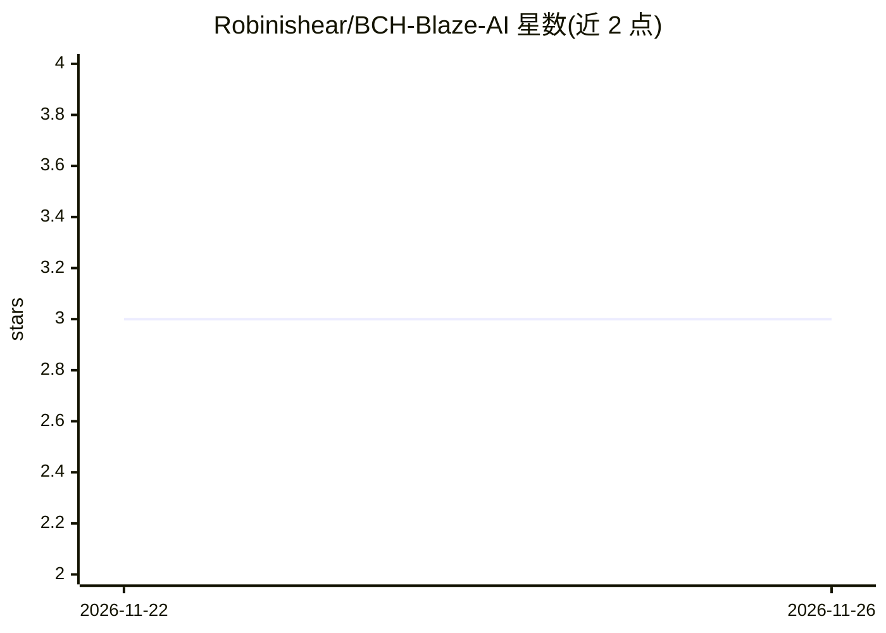

# Robinishear/BCH-Blaze-AI

⭐ 3 · TypeScript · 推送 2026-11-21 · [GitHub](https://github.com/Robinishear/BCH-Blaze-AI) · [官网](https://bch-blaze-client.onrender.com/) · 个人维护

**给终端用户按次付费的 BCH 支付 AI 分析服务**

面向终端用户的按次付费 AI 服务：每条请求生成一张带独立 BCH 地址的发票（15 分钟有效期，最多 5 张待付），服务端从 XPUB 派生地址并持有私钥，后台 watcher 在 BCH 网络上检测到足额付款后才调用 Gemini 生成结果；支持 market-insight（0.03 美元）与 prompt-suggest（0.02 美元）两个功能，并提供面向脚本与 AI agent 的免账号 HTTP 402 端点。部署用 Docker/Render Blueprint，付款使用真实主网 BCH，交易不可逆。

## 筛选速览

| 维度 | 判定 | 备注 |
|---|---|---|
| AI 角色 | `ai-native` | 本体是模型或模型工具 |
| 许可风险 | `none` | — |
| 部署形态 | `library` | 以包/库形式分发 |
| 模型依赖 | — | README 未给出锁定关系 |
| 硬件要求 | — | 无带数字的原话,不猜 |
| 安装摩擦 | `low` | 无编译、无系统依赖或容器化 |
| 成熟度 | — | 结构信号不足 |

## 能力要点

- 每张发票派生独立 BCH 地址，服务器仅持有 XPUB、不持有收款私钥
- 付款确认后才运行 AI，未付/过期发票不可执行，重复请求返回已存结果
- 免账号 HTTP 402 API 供脚本与 AI agent 获取付款指令并取回结果
- 支持 Electron Cash、Selene Wallet、Bitcoin.com Wallet 连接付款

## 适用场景

- 按次付费获取某个主题的简短市场分析文本
- 改进自己的提示词（一次获得五个版本）
- 让脚本或 AI agent 通过 402 端点自动付款调用 AI

## 场景标签

`AI 助手` `提示工程` · 领域:Agent 开发

## 证据(README 行号)

> L17: BCH Blaze AI sells small AI tasks one request at a time. Bitcoin Cash fees are tiny, so a payment of two or three c
> L116: |Gemini API|Generates the AI result after payment is confirmed|
> L23: |`market-insight`|A short analysis of a topic you provide|$0.03|

## 星数曲线

2026-11-22 3 → 2026-11-26 3（+0）

---
*卡片 v1 · prompt 1.4 · 生成 2026-11-22 · 置信度 mid · 依据 README sha `989296eccd6a` · [字段定义](../../DATASET.md)*
