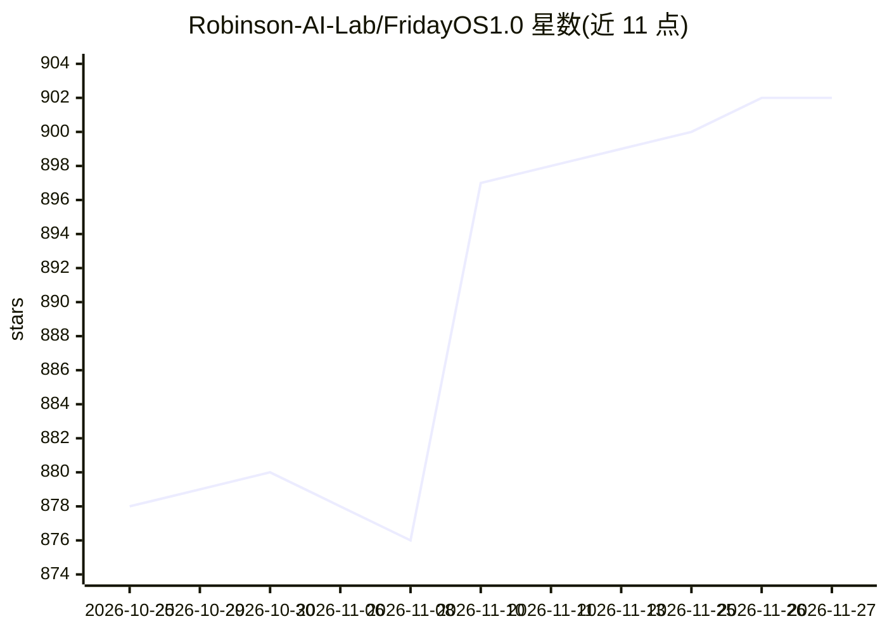

# Robinson-AI-Lab/FridayOS1.0

⭐ 902 · Python · MIT · 推送 2026-11-26 · [GitHub](https://github.com/Robinson-AI-Lab/FridayOS1.0) · [官网](https://github.com/Robinson-AI-Lab/FridayOS1.0/blob/main/docs/DEPLOYMENT.md) · 组织维护 · 中文 README

**本地优先的 AI 第二大脑方法论与 Markdown 知识管理蓝图**

围绕六脑法（捕获/执行/知识/技能/证据/规则）组织的个人知识管理项目：提供本地 Markdown 蓝图包、Obsidian 示例库、中英双语文指南与一个虚构公司沙盒示例（含 11 个练习提示词）。部署仅需 Python 3.9+，下载后可完全离线运行；知识以 Markdown 文件存储，配套工具示例为 Obsidian + Claudian + Claude Code + 兼容模型服务，且明确声明飞书并非必需。不做自动维护、备份或既有库迁移。

## 筛选速览

| 维度 | 判定 | 备注 |
|---|---|---|
| AI 角色 | `ai-knowledge` | 知识聚合/清单类 |
| 许可风险 | `permissive` | MIT |
| 部署形态 | `None` |  |
| 模型依赖 | — | README 未给出锁定关系 |
| 硬件要求 | — | 无带数字的原话,不猜 |
| 安装摩擦 | `low` | 无编译、无系统依赖或容器化 |
| 成熟度 | `idea` | |

## 能力要点

- 六脑分区方法：按职责划分知识库结构并以引用和反馈连接
- 完整离线蓝图包，含子脑、交付物、附件与工作/归档分区
- Obsidian 示例库与虚构公司沙盒及 11 个练习提示词
- 中英双语文档，Windows 部署验收已覆盖，macOS/Linux 待独立验证

## 适用场景

- 按六脑法搭建自己的本地 AI 第二大脑
- 在 Obsidian 中练习检索、关联与方法复用
- 为个人知识工作建立来源留痕与 AI 权限边界规则

## 场景标签

`知识库管理` · 领域:知识与检索

## 证据(README 行号)

> L9: FridayOS 1.0 is an open-source **personal knowledge management (PKM)** project built around the **Six-Brain Method**
> L70: **Deployment needs only Python 3.9+ and works offline after download.** Then choose your environment by tool role. 
> L74: - **Provided:** theory, a complete offline blueprint package, bilingual guides, tool references and a fictional dem

## 星数曲线

2026-10-25 878 → 2026-11-27 902（+24）

---
*卡片 v1 · prompt 1.4 · 生成 2026-11-25 · 置信度 mid · 依据 README sha `94d671df844d` · [字段定义](../../DATASET.md)*
