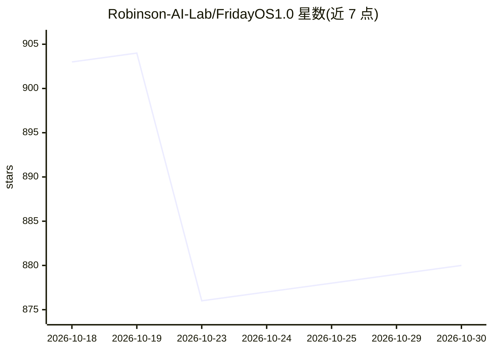

# Robinson-AI-Lab/FridayOS1.0

⭐ 880 · Python · MIT · 推送 2026-10-29 · [GitHub](https://github.com/Robinson-AI-Lab/FridayOS1.0) · [官网](https://github.com/Robinson-AI-Lab/FridayOS1.0/blob/main/docs/DEPLOYMENT.md) · 组织维护 · 中文 README

**AI 第二大脑实践项目：用 Obsidian+Claude Code 管理个人知识**

Robinson AI Lab 的开源实践项目（前名 FridayOS-Lite），以 Obsidian、本地 Markdown 文件、Claude Code 与 Claudian 插件搭建个人知识管理工作流：AI 在笔记侧边栏中负责捕捉、组织与检索，用户通过自然语言驱动知识库（VKM），按 FRIDAY-BLUEPRINT.md 一句话生成六区大脑结构。提供安装指南、FAQ 与一个虚构公司示例大脑（中文）。当前版本不含飞书机器人与自动化捕获；Agent OS 能力仍是研究方向。面向无开发经验的 AI 好奇者。

## 筛选速览

| 维度 | 判定 | 备注 |
|---|---|---|
| AI 角色 | `ai-knowledge` | 知识聚合/清单类 |
| 许可风险 | `permissive` | MIT |
| 部署形态 | `desktop` | 安装包/桌面程序 |
| 模型依赖 | locked-api |  |
| 硬件要求 | — | 无带数字的原话,不猜 |
| 安装摩擦 | `low` | 无编译、无系统依赖或容器化 |
| 成熟度 | `idea` | |

## 能力要点

- 以本地 Markdown 纯文本存储笔记，不锁定数据
- 六区大脑结构（Inbox/Workbench/Knowledge/Skills/Archive/Core）由蓝图文件一句话生成
- 提供含 100 人虚构公司数据的示例大脑与 11 条演示提示词
- 通过结构化 frontmatter 与 MAC 页面设计降低 token 消耗

## 适用场景

- 按指南搭建 AI 辅助的个人笔记与知识库
- 用自然语言让 AI 代为整理、归档和检索笔记
- 初学者通过示例大脑体验该工作流

## 场景标签

`知识库管理` · 领域:知识与检索

## 证据(README 行号)

> L13: Use **Obsidian + Claudian**, local Markdown files, and a brain blueprint to explore AI-assisted personal knowledge 
> L15: This version focuses on personal knowledge management. A Feishu bot, automated message capture, and a complete set 
> L31: You've heard of vibe coding — say what you want, the AI writes the code. **Vibe Knowledge Management (VKM)** is the

## 星数曲线

2026-10-18 903 → 2026-10-30 880（-23）

---
*卡片 v1 · prompt 1.4 · 生成 2026-10-21 · 置信度 mid · 依据 README sha `0e8cff2f2721` · [字段定义](../../DATASET.md)*
