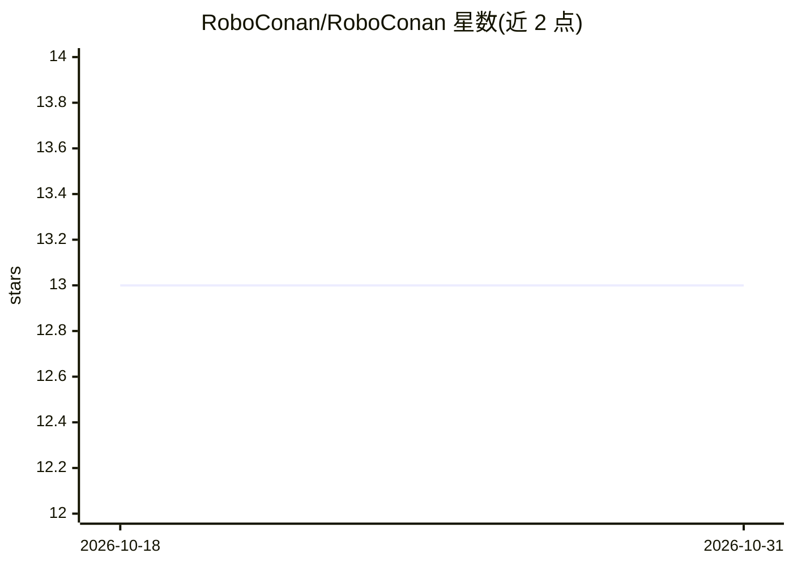

# RoboConan/RoboConan

⭐ 13 · Python · MIT · 推送 2026-10-28 · [GitHub](https://github.com/RoboConan/RoboConan) · [官网](https://github.com/valgur/conan-center-index) · 个人维护

**面向 CV/ML/机器人边缘设备的 Conan 包配方仓库（ConanCenter 分叉）**

Fork 自 ConanCenter 的纯配方（recipes-only）仓库，聚焦 CUDA、计算机视觉、机器学习与机器人依赖，尤其面向边缘设备。不提供预编译二进制，用户以 Conan v2.2+ 将其添加为 remote 后自行构建；设计上默认最小化选项、大量使用版本范围以精简依赖树。含 440 个额外配方与 8,000 次提交，覆盖 CUDA 工具链、TensorRT、CUDA 版 ONNX Runtime/PyTorch、llama.cpp/whisper.cpp、oneAPI、SLAM 与求解器库。README 自述当前为占位仓库，开发在另一仓库进行。

## 筛选速览

| 维度 | 判定 | 备注 |
|---|---|---|
| AI 角色 | `ai-ecosystem` | LLM/agent 周边工具 |
| 许可风险 | `permissive` | MIT |
| 部署形态 | `None` |  |
| 模型依赖 | — | README 未给出锁定关系 |
| 硬件要求 | — | 无带数字的原话,不猜 |
| 安装摩擦 | `medium` | 含编译或系统依赖之一 |
| 成熟度 | `idea` | |

## 能力要点

- CUDA 语言与 Toolkit 级支持，TensorRT 及 CUDA 版 ONNX Runtime/PyTorch 配方
- llama.cpp 与 whisper.cpp 配方支持 CUDA 及其他后端
- 完整 Intel oneAPI 支持与 SYCL 工具链
- 440 个额外配方，支持交叉编译到 linux-aarch64

## 适用场景

- 在边缘设备项目上用 Conan 管理 CV/ML/机器人 C++ 依赖
- 获取 ConanCenter 尚未收录或更新的库版本
- 自建二进制仓库以控制构建配置与依赖图

## 场景标签

 · 领域:软件包管理/CV·ML·机器人构建

## 证据(README 行号)

> L3: RoboConan is a recipes-only Conan repository, forked from ConanCenter to
> L4: deliver faster iteration, broader coverage (CV/ML/robotics, especially on
> L26: - Full CUDA support at both the language and Toolkit level. All of Nvidia's binary packages are available as well a
> L29: - llama.cpp and whisper.cpp with CUDA and all other backends supported.

## 星数曲线

2026-10-18 13 → 2026-10-31 13（+0）

---
*卡片 v1 · prompt 1.4 · 生成 2026-10-31 · 置信度 high · 依据 README sha `f47e95ada899` · [字段定义](../../DATASET.md)*
