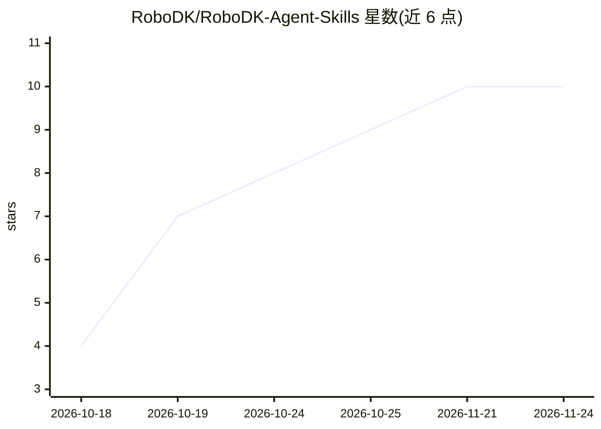

# RoboDK/RoboDK-Agent-Skills

⭐ 10 · Python · MIT · 推送 2026-10-06 · [GitHub](https://github.com/RoboDK/RoboDK-Agent-Skills) · [官网](https://robodk.com/) · 组织维护

**教 AI agent 操作 RoboDK 的技能包：建模、写 API 代码、生成机器人程序**

RoboDK 官方发布的 agent 技能集合，以 SKILL.md 格式供 Claude Code 等 AI 编码 agent 读取。包含 7 个技能：robodk-api 代码编写与移植（离线查找 API 签名）、参数化组件构建、站点结构审计、后处理器生成（KRL/RAPID/URScript 等）、驱动器编写、Add-in 打包，以及唯一可操作真实硬件的 robodk-real-robot-control。运行需已安装 RoboDK 与 Python 3.9+，通过符号链接安装到 agent 技能目录。部分技能有专有许可例外。

## 筛选速览

| 维度 | 判定 | 备注 |
|---|---|---|
| AI 角色 | `ai-ecosystem` | LLM/agent 周边工具 |
| 许可风险 | `permissive` | MIT |
| 部署形态 | `None` |  |
| 模型依赖 | — | README 未给出锁定关系 |
| 硬件要求 | — | 无带数字的原话,不猜 |
| 安装摩擦 | `low` | 无编译、无系统依赖或容器化 |
| 成熟度 | — | 结构信号不足 |

## 能力要点

- 7 个 SKILL.md 技能：API 编码、组件构建、审计、后处理器、驱动器、Add-in、真机控制
- robodk-api 技能捆绑 robodk 包，可离线查找 API 签名
- 后处理器技能生成 ABB/FANUC/KUKA/UR 等控制器代码
- 真机控制技能内置动作前显式确认

## 适用场景

- 用自然语言描述工位布局，让 agent 搭建并仿真机器人单元
- 调试与移植基于 RoboDK API 的多语言代码
- 为各品牌控制器生成并审计后处理器程序
- 将 Add-in 打包成 .rdkp 分发

## 场景标签

`编码 Agent` · 领域:编码与开发

## 证据(README 行号)

> L9: RoboDK Agent Skills teach AI agents such as Claude Code how to work with
> L20: ## The skills
> L24: |`robodk-api`|Write, port, or debug code against the RoboDK API — Python, C#, C++, MATLAB, TypeScript, C, Visual Ba

## 星数曲线

2026-10-18 4 → 2026-11-24 10（+6）

---
*卡片 v1 · prompt 1.4 · 生成 2026-11-21 · 置信度 high · 依据 README sha `da51944b93fd` · [字段定义](../../DATASET.md)*
