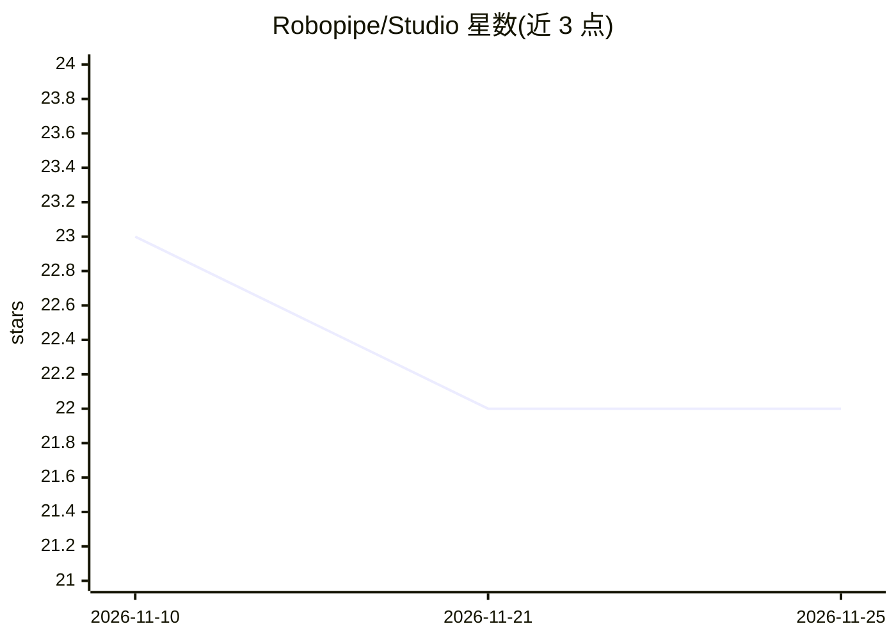

# Robopipe/Studio

⭐ 22 · TypeScript · MIT · 推送 2026-11-10 · [GitHub](https://github.com/Robopipe/Studio) · [官网](https://robopipe.io) · 组织维护

**生产线 AI 质检 Web 应用：采集、标注、训练并部署到边缘相机**

面向制造产线的 AI 视觉质控 Web 应用，覆盖采集、标注、训练、推理全流程：从局域网发现 Luxonis OAK 相机并采集图像，浏览器内标注，调用 luxonis-train 与 Ultralytics 训练检测/分割/分类模型，经 ONNX 与 Luxonis HubAI 转换后部署到边缘相机离线推理，支持 SAHI 切片推理处理小缺陷。后端提供 OpenAPI 文档与 JWT 多组织管理，图像与模型存储于 Google Cloud Storage。推理依赖 Robopipe API 与控制器硬件。

## 筛选速览

| 维度 | 判定 | 备注 |
|---|---|---|
| AI 角色 | `ai-native` | 本体是模型或模型工具 |
| 许可风险 | `permissive` | MIT |
| 部署形态 | `self-host` | docker 或自建部署 |
| 模型依赖 | — | README 未给出锁定关系 |
| 硬件要求 | — | 无带数字的原话,不猜 |
| 安装摩擦 | `low` | 无编译、无系统依赖或容器化 |
| 成熟度 | — | 结构信号不足 |

## 能力要点

- 采集-标注-训练-推理一体化的产线视觉质控流水线
- 模型导出 ONNX 并转换到 Luxonis RVC2/RVC3/RVC4 设备边缘推理
- 支持 luxonis-train 与 Ultralytics YOLO 两套训练服务
- REST API 带 OpenAPI 文档，可自动化每一步

## 适用场景

- 食品产线做缺陷、异物与份量检测
- 制药灌装、封盖与标签验证，如胶囊计数
- 物流场景做安全隐患实时检测
- 电商目录商品的自动打标

## 场景标签

`目标检测` · 领域:感知与多模态

## 证据(README 行号)

> L5: **Robopipe Studio is a web application for AI quality control on production lines. Quality and production teams use 
> L23: - **Infer.** Deploy a model to a camera through Robopipe API and see detections live. Sliced inference (SAHI) setti

## 星数曲线

2026-11-10 23 → 2026-11-25 22（-1）

---
*卡片 v1 · prompt 1.4 · 生成 2026-11-18 · 置信度 mid · 依据 README sha `37743051ea8d` · [字段定义](../../DATASET.md)*
