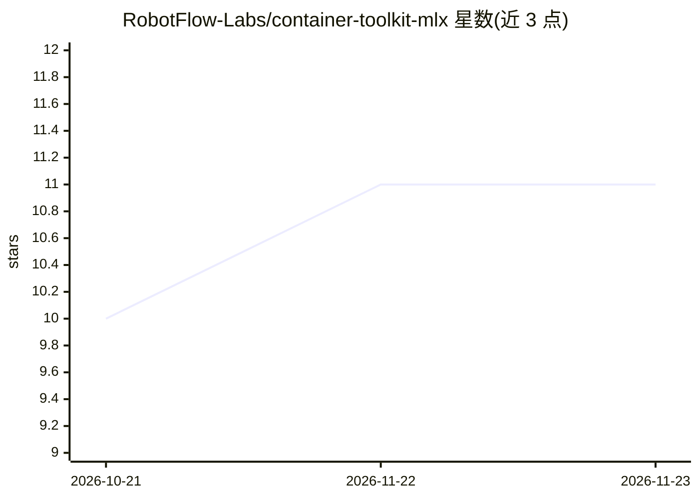

# RobotFlow-Labs/container-toolkit-mlx

⭐ 11 · Swift · MIT · 推送 2026-03-15 · [GitHub](https://github.com/RobotFlow-Labs/container-toolkit-mlx) · [官网](https://robotflowlabs.com) · 组织维护

**让 Linux 容器在 Apple Silicon 上调用主机 Metal GPU 跑 MLX 推理**

自述为 NVIDIA Container Toolkit 在 Apple Silicon 上的对应物：Apple 官方 container 在轻量 VM 中无 GPU 支持，该项目通过主机侧 Swift 守护进程加 vsock/gRPC 桥接，让容器内 Python 应用访问主机 Metal GPU 执行 MLX 推理。提供 mlx-ctk CLI（设备列表、守护进程生命周期、CDI spec 生成、runtime 配置）、Python 客户端 mlx-container（含 OpenAI 兼容接口与 mlx_lm 替换导入），实现 CDI v0.5.0 与 OCI hook。构建需 macOS 15+、Xcode 16+、Swift 6.0+。

## 筛选速览

| 维度 | 判定 | 备注 |
|---|---|---|
| AI 角色 | `ai-ecosystem` | LLM/agent 周边工具 |
| 许可风险 | `permissive` | MIT |
| 部署形态 | `self-host` | docker 或自建部署 |
| 模型依赖 | — | README 未给出锁定关系 |
| 硬件要求 | — | 无带数字的原话,不猜 |
| 安装摩擦 | `low` | 无编译、无系统依赖或容器化 |
| 成熟度 | — | 结构信号不足 |

## 能力要点

- 主机守护进程经 vsock 桥接，容器内可调用 Metal GPU 跑 MLX 模型
- Python 客户端提供 OpenAI ChatCompletion 兼容接口与 mlx_lm 替换导入
- 实现 CDI v0.5.0 规范与 OCI hook，集成 container 运行时
- mlx-ctk CLI 提供 GPU 状态查看（对标 nvidia-smi）与守护进程管理

## 适用场景

- 在 Apple Silicon 的 Linux 容器内运行需要 GPU 的 MLX 推理
- 容器内部署 OpenAI 兼容的推理 API 服务
- 在 macOS 上用 MLX 格式模型（如 mlx-community）做开发测试

## 场景标签

`推理引擎` · 领域:训练与推理

## 证据(README 行号)

> L11: The Apple Silicon equivalent of NVIDIA's Container Toolkit. Gives Linux containers running in Apple's lightweight V
> L114: The `mlx-ctk` CLI is your control plane — GPU introspection, daemon lifecycle, CDI spec management.
> L267: The toolkit implements the Container Device Interface spec (`v0.5.0`), following the same pattern as NVIDIA's `nvi

## 星数曲线

2026-10-21 10 → 2026-11-23 11（+1）

---
*卡片 v1 · prompt 1.4 · 生成 2026-11-20 · 置信度 high · 依据 README sha `7728700bc6bf` · [字段定义](../../DATASET.md)*
