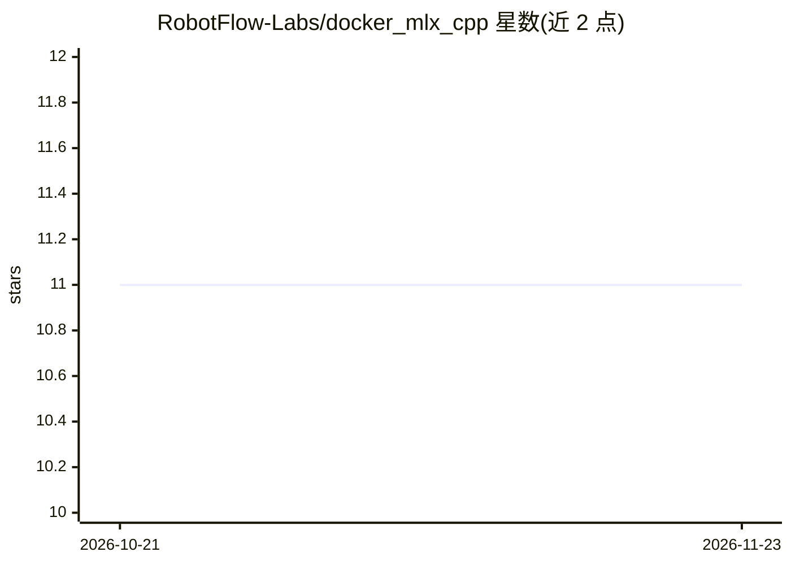

# RobotFlow-Labs/docker_mlx_cpp

⭐ 11 · Python · MIT · 推送 2026-04-01 · [GitHub](https://github.com/RobotFlow-Labs/docker_mlx_cpp) · [官网](https://robotflowlabs.com) · 组织维护

**让 Docker 容器通过 HTTP 网关使用 Mac Metal GPU 跑 AI 推理训练**

在 macOS 宿主机运行 MLX 守护进程，配合 Docker 网关容器把 Apple Silicon 的 Metal GPU 能力以 OpenAI 兼容 API 暴露给任意容器；提供聊天/补全/嵌入、Whisper 转录、TTS、SD/SDXL/FLUX 图像生成、LoRA/QLoRA 微调端点及 107 个 GPU 计算操作。请求经 HTTP 转发有 1-5ms 开销，多容器请求串行执行，不支持 Intel Mac。提供 CLI、docker-compose 集成与项目脚手架。

## 筛选速览

| 维度 | 判定 | 备注 |
|---|---|---|
| AI 角色 | `ai-ecosystem` | LLM/agent 周边工具 |
| 许可风险 | `permissive` | MIT |
| 部署形态 | `self-host` | docker 或自建部署 |
| 模型依赖 | — | README 未给出锁定关系 |
| 硬件要求 | — | 无带数字的原话,不猜 |
| 安装摩擦 | `low` | 无编译、无系统依赖或容器化 |
| 成熟度 | — | 结构信号不足 |

## 能力要点

- OpenAI 兼容端点覆盖推理、嵌入、音频转录/TTS、图像生成
- LoRA/QLoRA/DPO 微调端点与模型拉取管理 API
- 107 个 GPU 计算操作，含 Flash Attention、FFT、卷积等 15 类
- mlx-cpp CLI 与 docker init 项目脚手架

## 适用场景

- 容器内应用通过 OpenAI SDK 调用 Mac 本地 GPU 推理
- 在 Apple Silicon 上做 LoRA 微调实验
- 容器内跑 Whisper 转录与图像生成任务

## 场景标签

`图像生成` `语音合成` `语音识别` `微调` · 领域:内容生成

## 证据(README 行号)

> L37: **docker_mlx_cpp** solves this by running a host-side MLX daemon that exposes the full Apple Silicon GPU stack to a
> L143: 1. **MLX Daemon** runs natively on macOS with direct Metal GPU access
> L145: 3. **Any container** calls the gateway using standard OpenAI API — no special runtime needed

## 星数曲线

2026-10-21 11 → 2026-11-23 11（+0）

---
*卡片 v1 · prompt 1.4 · 生成 2026-11-18 · 置信度 high · 依据 README sha `b127c24776c4` · [字段定义](../../DATASET.md)*
