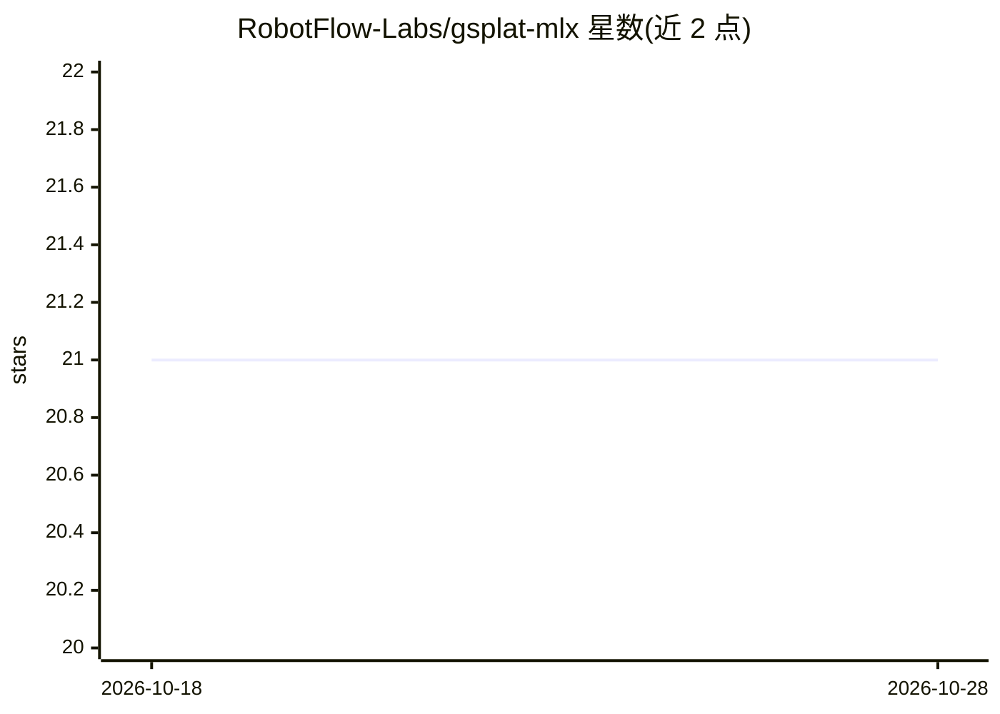

# RobotFlow-Labs/gsplat-mlx

⭐ 21 · Python · 推送 2026-03-15 · [GitHub](https://github.com/RobotFlow-Labs/gsplat-mlx) · [官网](https://robotflowlabs.com/) · 组织维护

**gsplat 的 MLX 移植：在 Apple Silicon 上原生运行 3DGS**

将 nerfstudio-project/gsplat 从 CUDA/PyTorch 移植到 Apple MLX 的 3D Gaussian Splatting 库，在 M1-M4 上通过 Metal GPU 运行可微光栅化管线。包含协方差计算、球谐求值（0-4 阶）、投影（针孔/鱼眼/正交）、光栅化、致密化策略、SelectiveAdam 优化器、2DGS surfel 变体与端到端训练管线，API 与上游 gsplat 兼容以便 SplaTAM/MonoGS/nerfstudio 等下游项目迁移。反向传播通过 @mx.custom_function + .vjp 实现；当前光栅化为 Tier-2 实现（Python 循环 + GPU 向量化），Tier-3 Metal shader 尚在计划中。405 个测试。源码安装，需 macOS Apple Silicon、Python>=3.10、MLX>=0.31。

## 筛选速览

| 维度 | 判定 | 备注 |
|---|---|---|
| AI 角色 | `ai-native` | 本体是模型或模型工具 |
| 许可风险 | `permissive` | — |
| 部署形态 | `library` | 以包/库形式分发 |
| 模型依赖 | — | README 未给出锁定关系 |
| 硬件要求 | — | 无带数字的原话,不猜 |
| 安装摩擦 | `medium` | 含编译或系统依赖之一 |
| 成熟度 | — | 结构信号不足 |

## 能力要点

- 协方差/投影/球谐/光栅化全管线在 Metal GPU 上可微运行
- 同时支持 3DGS 与 surfel-based 2DGS
- API 与上游 gsplat 兼容，便于下游 3DGS 项目迁移
- 405 个测试覆盖前向正确性、VJP 验证与端到端训练收敛

## 适用场景

- 在没有 NVIDIA GPU 的 Mac 上进行 3DGS 研究与训练
- 将依赖 gsplat 的项目（SplaTAM/MonoGS/nerfstudio）迁移到 MLX
- 渲染与优化高斯泼溅场景（含深度/法线等输出）

## 场景标签

`图像视频处理` · 领域:感知与多模态

## 证据(README 行号)

> L3: **3D Gaussian Splatting on Apple Silicon -- Native MLX port of gsplat**
> L15:  Source     33 files    6,815 lines    100% GPU (Metal) differentiable pipeline
> L193: **API-compatible with upstream gsplat.** Function signatures mirror the original so that downstream projects (Spla

## 星数曲线

2026-10-18 21 → 2026-10-28 21（+0）

---
*卡片 v1 · prompt 1.4 · 生成 2026-10-28 · 置信度 mid · 依据 README sha `0a9340a44220` · [字段定义](../../DATASET.md)*
