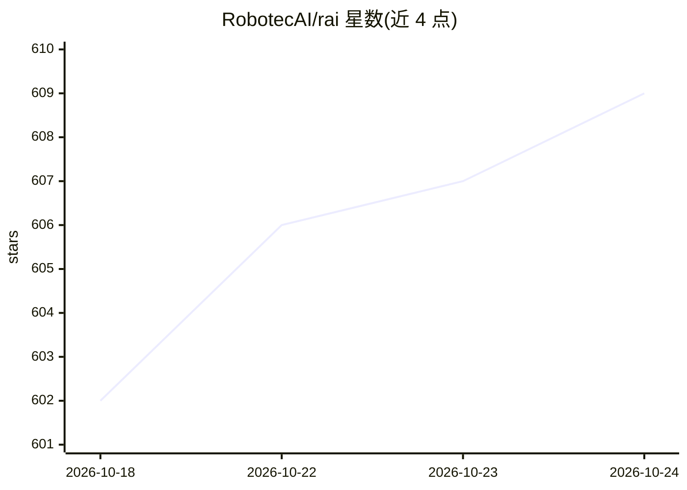

# RobotecAI/rai

⭐ 609 · Python · Apache-2.0 · 推送 2026-10-12 · [GitHub](https://github.com/RobotecAI/rai) · 组织维护

**面向物理机器人/具身 AI 的厂商无关 agentic 框架（ROS 2）**

RAI 是一个用于在机器人上开发与部署具身 AI 功能的 agentic 框架，基于 ROS 2 工具执行复杂动作、定义场景与自由接口执行，支持日志摘要与语音交互。模块包括多智能体核心（rai core）、机器人本体信息提取（rai whoami）、语音转文本与文本转语音（rai_asr/rai_tts）、仿真连接（rai_sim）、基准测试（rai_bench）、基于开放集模型的目标检测（rai_perception）、NoMaD 导航集成，LLM 微调模块（rai_finetune）尚未完成。提供拖拉机、机械臂、移动机器人等多个仿真演示。

## 筛选速览

| 维度 | 判定 | 备注 |
|---|---|---|
| AI 角色 | `ai-ecosystem` | LLM/agent 周边工具 |
| 许可风险 | `permissive` | Apache-2.0 |
| 部署形态 | `None` |  |
| 模型依赖 | — | README 未给出锁定关系 |
| 硬件要求 | — | 无带数字的原话,不猜 |
| 安装摩擦 | `low` | 无编译、无系统依赖或容器化 |
| 成熟度 | — | 结构信号不足 |

## 能力要点

- 多智能体系统核心，支持人机交互与多模态数据处理
- rai_asr/rai_tts 语音交互与 rai_perception 开放集目标检测工具
- rai_sim 连接仿真环境，提供果园推理、机械臂操控等演示
- rai_bench 可对 agent、模型、工具与仿真器做基准测试

## 适用场景

- 在 ROS 2 机器人上集成 LLM 驱动的多智能体任务执行
- 通过自然语言控制机械臂或移动机器人完成操控任务
- 在仿真环境中测试具身 AI agent 并进行基准评测

## 场景标签

`多智能体` `Agent 框架` · 领域:Agent 开发

## 证据(README 行号)

> L3: RAI is a flexible AI agent framework to develop and deploy Embodied AI features for your robots.
> L33: - [x] rai core: Core functionality for multi-agent system, human-robot interaction and

## 星数曲线

2026-10-18 602 → 2026-10-24 609（+7）

---
*卡片 v1 · prompt 1.4 · 生成 2026-10-21 · 置信度 mid · 依据 README sha `d0d53482d4fa` · [字段定义](../../DATASET.md)*
