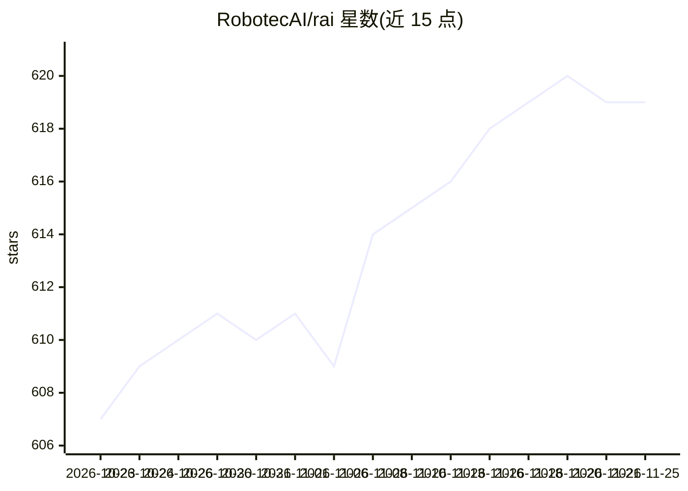

# RobotecAI/rai

⭐ 619 · Python · Apache-2.0 · 推送 2026-11-23 · [GitHub](https://github.com/RobotecAI/rai) · 组织维护

**给机器人开发者的具身智能 agent 框架**

RAI 是一个面向机器人具身智能开发的 agent 框架，基于 ROS 2 工具执行复杂动作、场景定义与自由接口执行。框架由多个子包组成：rai core 提供多智能体系统与人机交互核心功能，rai_whoami 从文档/图像/URDF 提取机器人本体信息，rai_asr/rai_tts 提供语音识别与合成，rai_sim 连接仿真环境，rai_bench 提供基准测试，rai_perception 提供基于开放集模型的目标检测；rai_finetune 尚未完成。提供文档站与多个仿真演示，附 BibTeX 引用条目。

## 筛选速览

| 维度 | 判定 | 备注 |
|---|---|---|
| AI 角色 | `ai-ecosystem` | LLM/agent 周边工具 |
| 许可风险 | `permissive` | Apache-2.0 |
| 部署形态 | `None` |  |
| 模型依赖 | — | README 未给出锁定关系 |
| 硬件要求 | — | 无带数字的原话,不猜 |
| 安装摩擦 | `low` | 无编译、无系统依赖或容器化 |
| 成熟度 | — | 结构信号不足 |

## 能力要点

- 多智能体系统核心（rai core）支持多模态人机交互
- rai_asr/rai_tts 提供语音转文本与文本转语音工具
- rai_sim 连接仿真环境，rai_bench 提供智能体/模型/工具基准测试
- rai_perception 基于开放集模型的目标检测工具

## 适用场景

- 为 ROS 2 机器人集成生成式 AI 能力
- 用自然语言指挥机械臂完成操作任务
- 对机器人智能体、模型与工具做基准测试
- 通过仿真演示验证移动机器人导航与控制场景

## 场景标签

`Agent 框架` `多智能体` `模型评测` · 领域:Agent 开发

## 证据(README 行号)

> L3: RAI is a flexible AI agent framework to develop and deploy Embodied AI features for your robots.
> L30: - [x] rai core: Core functionality for multi-agent system, human-robot interaction and
> L37: - [x] rai_bench: Benchmarking suite for RAI. Test agents, models, tools, simulators, etc.

## 星数曲线

2026-10-23 607 → 2026-11-25 619（+12）

---
*卡片 v1 · prompt 1.4 · 生成 2026-11-25 · 置信度 mid · 依据 README sha `f7a516e0255c` · [字段定义](../../DATASET.md)*
