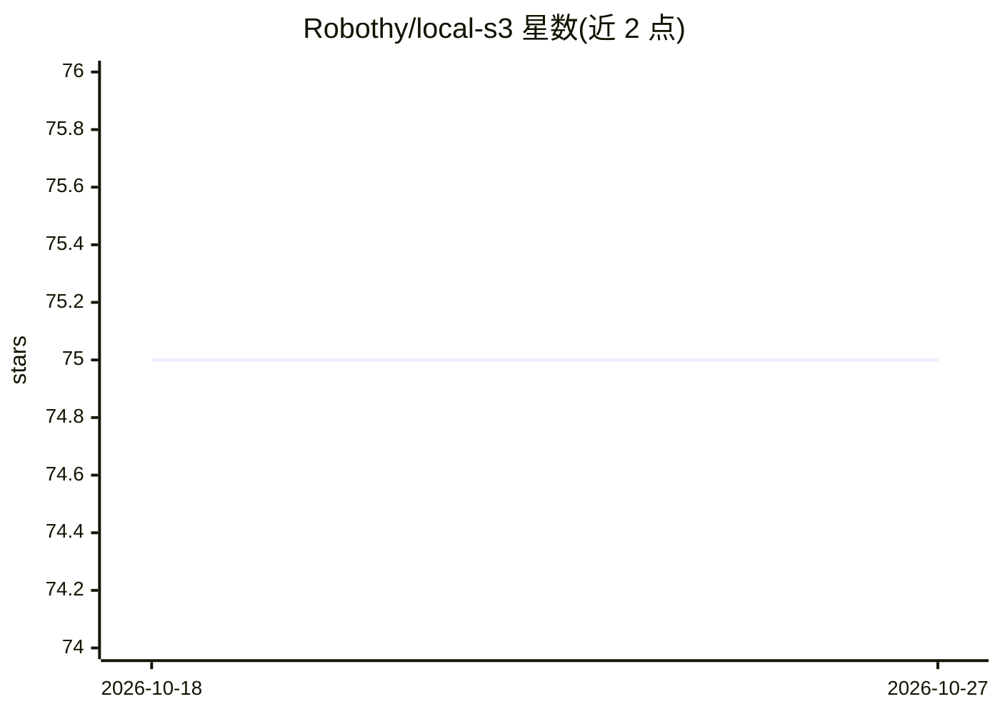

# Robothy/local-s3

⭐ — · [GitHub]() · 个人维护

**给 Java 开发者的 Amazon S3 mock 服务，用于测试与本地开发**

基于 Netty 实现的 Amazon S3 mock 服务，供测试与本地开发使用。支持 50 余种 S3 API（含对象、桶策略、多段上传）及 S3 Vectors 矢量桶/索引/向量操作。提供内存与持久化两种运行模式，可通过 Java API 嵌入应用、JUnit5 扩展注解 @LocalS3 自动注入 AmazonS3/S3Client/S3VectorsClient 客户端、Docker 镜像及 testcontainers 实现多种使用途径。以 Maven 依赖形式分发，无重量级依赖。

## 筛选速览

| 维度 | 判定 | 备注 |
|---|---|---|
| AI 角色 | `ai-ecosystem` | LLM/agent 周边工具 |
| 许可风险 | `permissive` | — |
| 部署形态 | `self-host` | docker 或自建部署 |
| 模型依赖 | — | README 未给出锁定关系 |
| 硬件要求 | — | 无带数字的原话,不猜 |
| 安装摩擦 | `low` | 无编译、无系统依赖或容器化 |
| 成熟度 | — | 结构信号不足 |

## 能力要点

- 支持 50+ Amazon S3 API 与 S3 Vectors 向量存储/相似性检索操作
- 内存模式与持久化模式，可从指定路径加载初始数据
- JUnit5 扩展自动向测试方法注入 AmazonS3/S3Client/S3VectorsClient 实例
- 提供 Docker 镜像与 testcontainers 实现

## 适用场景

- 本地开发与集成测试中替代真实 Amazon S3
- 在 JUnit5 测试中快速启动 S3 服务并注入客户端
- 用 testcontainers 在测试中运行 S3 mock 容器

## 场景标签

 · 领域:开发工具/云服务模拟

## 证据(README 行号)

> L9: LocalS3 is an Amazon S3 mock service for testing and local development. LocalS3 is based on Netty
> L85: + Support S3 Vectors for vector storage and similarity search.
> L221: LocalS3 provides a testcontainers implementation. You can run LocalS3 in your tests

## 星数曲线

2026-10-18 75 → 2026-10-27 75（+0）

---
*卡片 v1 · prompt 1.4 · 生成 2026-10-24 · 置信度 high · 依据 README sha `8d0adb170669` · [字段定义](../../DATASET.md)*
