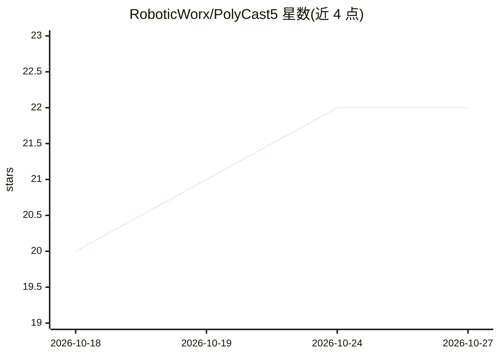

# RoboticWorx/PolyCast5

⭐ 22 · C · NOASSERTION · 推送 2026-10-23 · [GitHub](https://github.com/RoboticWorx/PolyCast5) · [官网](https://www.polycast5.com) · 组织维护

**ESP32 开源多协议无线遥控器固件，AI 语音键盘与红外/LoRa 控制一体**

面向 PolyCast5 硬件的开源固件（C 语言，基于 ESP-IDF v6.0.1 与 FreeRTOS 任务架构）：功能包括 LoRa 加密控制 PolyPlug 插座、蓝牙 HID 自动输入脚本引擎、Wi-Fi 嗅探（含 AI 数据包分析生成 .md 报告）、云端 AI 语音转写并蓝牙执行命令的语音键盘、离线密码管理、Meshtastic LoRa 网格通信、红外学习遥控、内置游戏与离线工具，支持 OTA 升级。仓库提供 flash.py 烧写脚本、桌面 LVGL+SDL2 模拟器与预编译固件。许可为 CC BY-NC-SA 4.0。

## 筛选速览

| 维度 | 判定 | 备注 |
|---|---|---|
| AI 角色 | `ai-enhanced` | 去掉 AI 部分产品仍成立 |
| 许可风险 | `none` | NOASSERTION |
| 部署形态 | `None` |  |
| 模型依赖 | — | README 未给出锁定关系 |
| 硬件要求 | — | 无带数字的原话,不猜 |
| 安装摩擦 | `low` | 无编译、无系统依赖或容器化 |
| 成熟度 | — | 结构信号不足 |

## 能力要点

- AI 语音键盘：录音经云端 AI 转写并执行，支持听写与自定义命令
- LoRa 加密插座控制、ESP-NOW 命令、红外学习与 Meshtastic 网格通信
- Wi-Fi 嗅探并由 AI 解读数据帧，输出 .md 报告
- FreeRTOS 任务化架构，含桌面模拟器与 OTA 更新

## 适用场景

- 用一台设备统一控制插座、电视、空调等红外与自制 ESP32 设备
- 对着遥控器说话让配对电脑执行打开网页等自定义命令
- 嗅探并查看 Wi-Fi 网络用户与安全信息，借助 AI 生成分析报告
- 离线保存密码并通过蓝牙自动填入任意设备

## 场景标签

`网络安全` · 领域:学习与行业

## 证据(README 行号)

> L11: PolyCast5 is a open-source multi-tool wireless remote that you can use to control outlets, custom devices, bluetoot
> L69:  * `ai` - Runs `ai_task`: records from the I2S MEMS microphone, sends audio and prompts to a cloud AI API for speec

## 星数曲线

2026-10-18 20 → 2026-10-27 22（+2）

---
*卡片 v1 · prompt 1.4 · 生成 2026-10-27 · 置信度 high · 依据 README sha `cca060f3c8ef` · [字段定义](../../DATASET.md)*
