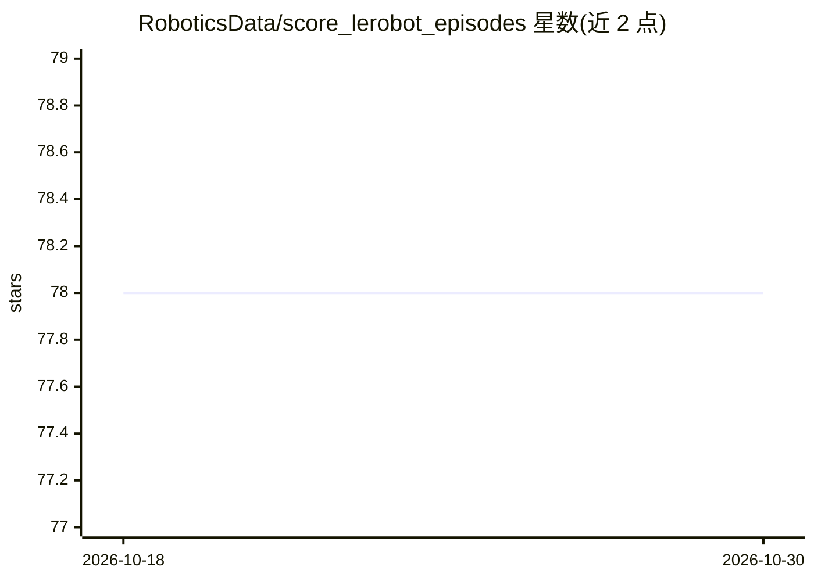

# RoboticsData/score_lerobot_episodes

⭐ 78 · Python · Apache-2.0 · 推送 2026-03-13 · [GitHub](https://github.com/RoboticsData/score_lerobot_episodes) · 组织维护

**给机器人学习研究者的 LeRobot 数据集质量评分与过滤工具**

面向 LeRobot 机器人演示数据集的评估工具包：从 HuggingFace Hub 或本地路径读取数据集，对每个 episode 在清晰度、运动平滑度、碰撞、关节稳定性、夹爪一致性、执行器饱和、时长异常等多维度计算 0–1 评分；视觉维度可用 OpenCV 启发式或可选的 Gemini 视觉语言模型评分（需 API key）。支持按阈值过滤低分 episode 并保持 LeRobot 数据结构，可调用 LeRobot 训练管线对比基线与过滤后数据集的模型表现（默认 ACT 策略、WandB 记录）。以 git clone + pip/uv 安装方式提供。README 顶部注明功能已整合进 Robotdata Studio。

## 筛选速览

| 维度 | 判定 | 备注 |
|---|---|---|
| AI 角色 | `ai-ecosystem` | LLM/agent 周边工具 |
| 许可风险 | `permissive` | Apache-2.0 |
| 部署形态 | `library` | 以包/库形式分发 |
| 模型依赖 | — | README 未给出锁定关系 |
| 硬件要求 | — | 无带数字的原话,不猜 |
| 安装摩擦 | `low` | 无编译、无系统依赖或容器化 |
| 成熟度 | — | 结构信号不足 |

## 能力要点

- 9 个质量维度对 episode 打 0–1 分（CV 启发式 + 可选 Gemini VLM 任务成功判定）
- 按阈值过滤数据集并保留 LeRobot 结构
- 集成 LeRobot 训练管线，对比基线 vs 过滤数据集模型（默认 ACT）
- 支持 HuggingFace Hub 下载或本地数据集，输出 JSON 评分与分布可视化

## 适用场景

- 给机器人演示数据集做质量评分并过滤低分 episode
- 训练前清洗数据以对比过滤前后模型效果
- 定位模糊、运动不平稳或碰撞异常的问题 episode

## 场景标签

 · 领域:机器人/机器学习数据工程

## 证据(README 行号)

> L20: A comprehensive toolkit for evaluating and filtering LeRobot episode datasets based on multiple quality dimensions.
> L41: |Task success (VLM)|`score_task_success` (via `VLMInterface`)|Gemini grades whether the desired behaviour happened|
> L201: The toolkit integrates with LeRobot's training pipeline to compare baseline vs. filtered dataset performance.

## 星数曲线

2026-10-18 78 → 2026-10-30 78（+0）

---
*卡片 v1 · prompt 1.4 · 生成 2026-10-24 · 置信度 high · 依据 README sha `17fdb149504f` · [字段定义](../../DATASET.md)*
