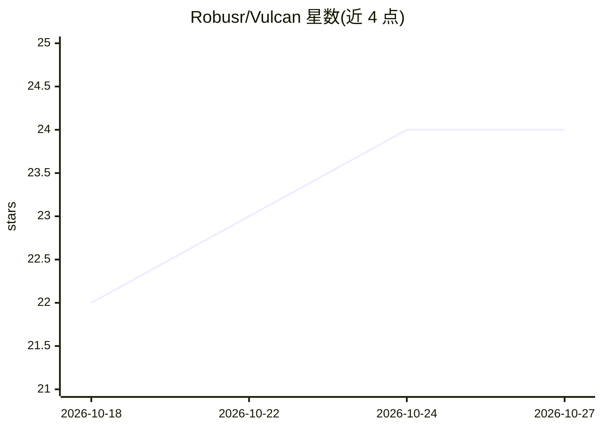

# Robusr/Vulcan

⭐ 24 · C# · GPL-3.0 · 推送 2026-10-20 · [GitHub](https://github.com/Robusr/Vulcan) · 个人维护 · 中文 README

**SolidWorks AI 插件：自然语言生成可编辑参数化特征**

由 C#/.NET 4.8 客户端（SolidWorks 2025 插件）与 Python/Flask 服务端组成的 AI 建模工具：用户在插件面板输入中/英/法文请求，服务端拼接版本化的 SolidWorks 领域提示词并调用任意 OpenAI 兼容端点，模型返回类型化 JSON 特征树，客户端通过 SolidWorks COM API（FeatureExtrusion3/FeatureCut4）执行，生成可编辑的原生特征而非网格或脚本。支持圆/矩形/多边形/椭圆/槽五种轮廓与四角通孔启发式；当前草图归一化到前视基准面，通用平面路由在路线图中。密钥保存在服务端，服务端可本地、Docker 或隧道部署。

## 筛选速览

| 维度 | 判定 | 备注 |
|---|---|---|
| AI 角色 | `ai-native` | 本体是模型或模型工具 |
| 许可风险 | `viral` | GPL-3.0 |
| 部署形态 | `desktop` | 安装包/桌面程序 |
| 模型依赖 | local-ok | 支持本地模型 |
| 硬件要求 | — | 无带数字的原话,不猜 |
| 安装摩擦 | `low` | 无编译、无系统依赖或容器化 |
| 成熟度 | — | 结构信号不足 |

## 能力要点

- LLM 输出类型化 JSON 特征树，C# 客户端确定性执行，无 exec()
- 支持任意 OpenAI 兼容端点（DeepSeek/Qwen/Ollama/vLLM 等）
- 生成可编辑的原生 SolidWorks 特征（拉伸/切除）
- COM 失败时键盘驱动回退到原生特征面板

## 适用场景

- 用一句话让 SolidWorks 生成带孔底板等参数化零件
- 减少重复的草图-拉伸-打孔点击操作流程
- 通过 REST API 服务端做批量的提示词到特征树生成

## 场景标签

 · 领域:CAD/AI 应用

## 证据(README 行号)

> L5:  Natural language in. Parametric SolidWorks geometry out.
> L50: 2. **The model fills a schema.** The server prepends a versioned SolidWorks domain prompt and calls any OpenAI-comp
> L51: 3. **The add-in builds it.** The C# client deserializes the tree, draws sketches, and calls the SolidWorks COM API.

## 星数曲线

2026-10-18 22 → 2026-10-27 24（+2）

---
*卡片 v1 · prompt 1.4 · 生成 2026-10-27 · 置信度 high · 依据 README sha `03bf0074cd89` · [字段定义](../../DATASET.md)*
