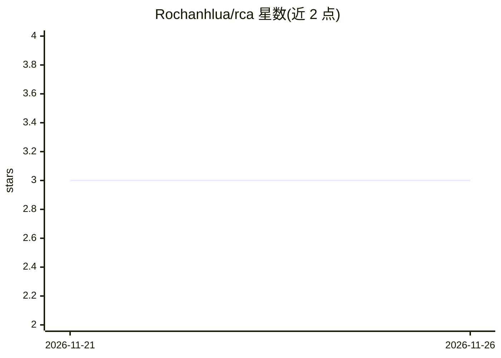

# Rochanhlua/rca

⭐ 3 · Rust · MIT · 推送 2026-11-24 · [GitHub](https://github.com/Rochanhlua/rca) · 个人维护

**AI 原生编程语言：内置张量与自动微分，Rust 实现**

RCA 是一门独立的静态类型编程语言，采用缩进式语法，编译器用 Rust 编写，可编译为原生代码（Cranelift）。语言内置张量运算与反向模式自动微分，提供 linear/conv2d/softmax/mse/sgd 等神经网络内建函数，通过组合可构建训练循环与前向推理。附带编译器工具链（lex/parse/check/lsp/debugger/coverage 等）、包管理器和 14 个标准库模块。当前为 v0.1.0 公测，仅支持 CPU 与 Float 类型，不支持 GPU。

## 筛选速览

| 维度 | 判定 | 备注 |
|---|---|---|
| AI 角色 | `ai-native` | 本体是模型或模型工具 |
| 许可风险 | `permissive` | MIT |
| 部署形态 | `None` |  |
| 模型依赖 | — | README 未给出锁定关系 |
| 硬件要求 | — | 无带数字的原话,不猜 |
| 安装摩擦 | `medium` | 含编译或系统依赖之一 |
| 成熟度 | `idea` | |

## 能力要点

- 内置张量类型与反向模式自动微分（track/grad）
- 神经网络内建函数：linear、conv2d、softmax、mse、sgd
- 完整工具链：LSP、调试器、覆盖率、基准测试、REPL、包管理器
- 可编译为原生代码（Cranelift）或运行于字节码 VM

## 适用场景

- 用单一语言编写含张量运算与梯度训练的程序
- 实验编译器工具链（LSP、调试器、覆盖率分析）
- 在教学或原型中演示自动微分与神经网络训练

## 场景标签

 · 领域:编程语言/ML 基础设施

## 证据(README 行号)

> L5: RCA is an independent, statically typed programming language with an
> L8: The long-term goal is an AI-native language with a native tensor engine.
> L111: Tensors and AI (CPU, Float only):

## 星数曲线

2026-11-21 3 → 2026-11-26 3（+0）

---
*卡片 v1 · prompt 1.4 · 生成 2026-11-22 · 置信度 high · 依据 README sha `e8019dae6343` · [字段定义](../../DATASET.md)*
