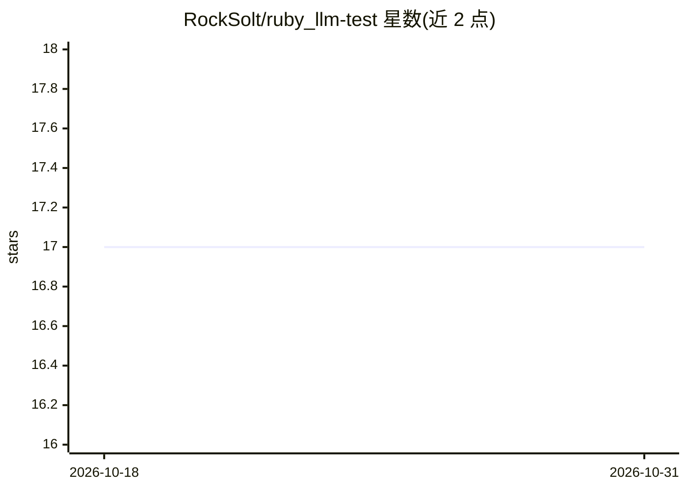

# RockSolt/ruby_llm-test

⭐ 17 · Ruby · MIT · 推送 2026-09-29 · [GitHub](https://github.com/RockSolt/ruby_llm-test) · 个人维护

**给 Ruby 开发者的 RubyLLM 调用测试打桩 gem**

RubyLLM::Test 是一个 Ruby gem，为使用 RubyLLM 库的应用提供测试打桩能力：将 LLM 视为外部系统，在测试中用 stub_response/stub_responses 替换真实 LLM 调用，支持字符串（包装为 assistant 角色的 Message）、Message 对象、Hash（转为 JSON 内容）及块形式打桩。无需 API 或特定 provider 知识，可通过 requests/last_request 检查传给 LLM 的参数与工具类。通过 Gemfile 或 gem install 安装，需在测试 helper 中 require 并 prepend 模块，MIT 许可。

## 筛选速览

| 维度 | 判定 | 备注 |
|---|---|---|
| AI 角色 | `ai-ecosystem` | LLM/agent 周边工具 |
| 许可风险 | `permissive` | MIT |
| 部署形态 | `None` |  |
| 模型依赖 | — | README 未给出锁定关系 |
| 硬件要求 | — | 无带数字的原话,不猜 |
| 安装摩擦 | `low` | 无编译、无系统依赖或容器化 |
| 成熟度 | — | 结构信号不足 |

## 能力要点

- 以字符串/Message/Hash 多种形式打桩 LLM 响应
- 通过 requests/last_request 与 tool_classes 检查传给 LLM 的参数
- 块形式 with_responses 自动处理打桩的建立与清理
- 无需 API 或 provider 专门知识即可打桩

## 适用场景

- 对使用 RubyLLM 的业务逻辑写快速、稳定的测试
- 验证应用传给 LLM 的提示词与工具参数
- 避免测试中真实调用 LLM 产生的不确定性与开销

## 场景标签

 · 领域:LLM 应用测试工具

## 证据(README 行号)

> L8: How do you test your business logic when it interacts with large language models (LLMs)? From a testing point of vie
> L10: Part of the appeal of the RubyLLM library is that code using it does not need to know the specifics of provider API

## 星数曲线

2026-10-18 17 → 2026-10-31 17（+0）

---
*卡片 v1 · prompt 1.4 · 生成 2026-10-30 · 置信度 high · 依据 README sha `ad5becec77c2` · [字段定义](../../DATASET.md)*
