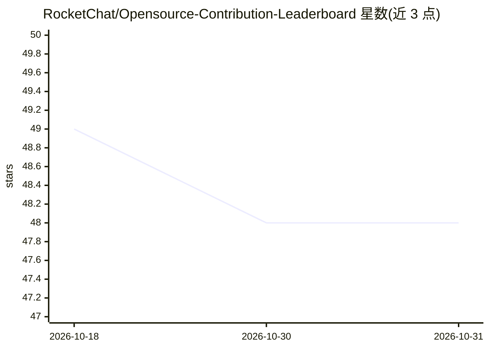

# RocketChat/Opensource-Contribution-Leaderboard

⭐ 48 · JavaScript · MIT · 推送 2026-04-08 · [GitHub](https://github.com/RocketChat/Opensource-Contribution-Leaderboard) · [官网](https://gsoc.rocket.chat) · 组织维护

**追踪 GitHub 组织开源贡献（PR/issue）的实时排行榜**

基于 Node.js/Express 与原生前端的 Web 应用：定时调用 GitHub API，统计组织内各仓库贡献者的开放 PR、合并 PR 与 issue 数量，结果写入 data.json（无需数据库），前端与 REST API 同步读取，并通过 socket.io 向客户端推送实时更新。内置管理面板维护贡献者名单与运行时配置，提供 /api/stats、/api/rank、/api/contributor 等接口。附带 AGENTS.md 与 GEMINI.md 供 AI 编码代理使用，属开发辅助配置而非产品功能。需 Node.js v12+ 与 GitHub token。

## 筛选速览

| 维度 | 判定 | 备注 |
|---|---|---|
| AI 角色 | `ai-enhanced` | 去掉 AI 部分产品仍成立 |
| 许可风险 | `permissive` | MIT |
| 部署形态 | `None` |  |
| 模型依赖 | — | README 未给出锁定关系 |
| 硬件要求 | — | 无带数字的原话,不猜 |
| 安装摩擦 | `low` | 无编译、无系统依赖或容器化 |
| 成熟度 | — | 结构信号不足 |

## 能力要点

- 后台自动刷新，统计贡献者的开放/合并 PR 与 issue
- 无数据库设计：结果写入 data.json，socket.io 实时推送
- 内置管理面板与三个 REST API 端点
- 提供 AGENTS.md/GEMINI.md 供 AI 编码代理读取项目上下文

## 适用场景

- 我要给组织搭建开源贡献可视化榜单
- GSoC 等社区活动中追踪成员的贡献进度
- 通过 API 把排行榜数据接入其他系统

## 场景标签

 · 领域:开发者工具/社区管理

## 证据(README 行号)

> L3: A real-time leaderboard that tracks open source contributions (PRs and issues) across your GitHub organization. Buil
> L121: - AGENTS.md — context for any AI coding agent (Copilot, Cursor, Windsurf, Cline, etc.)

## 星数曲线

2026-10-18 49 → 2026-10-31 48（-1）

---
*卡片 v1 · prompt 1.4 · 生成 2026-10-24 · 置信度 mid · 依据 README sha `d03785014958` · [字段定义](../../DATASET.md)*
