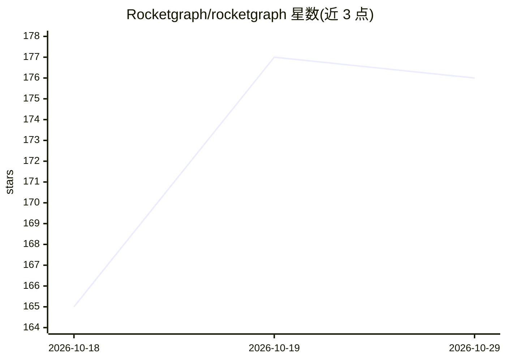

# Rocketgraph/rocketgraph

⭐ 176 · Python · NOASSERTION · 推送 2026-06-03 · [GitHub](https://github.com/Rocketgraph/rocketgraph) · [官网](https://rocketgraph.app) · 组织维护

**自托管日志聚类与流式异常检测层，运行在现有可观测性栈旁**

自托管的日志分析引擎：从 Loki、Datadog、New Relic、CloudWatch、Sentry、ClickHouse 或本地日志文件拉取日志窗口，用三个确定性算法（Drain3 挖掘结构模板、Isolation Forest 打分、Half-Space-Trees 实时检测新日志）聚类并标记异常，无 LLM 参与、结果可复现；可选 --ai 参数调用 Claude 对聚类结果做 SRE 式分诊。日志不离开用户网络，通过 docker compose 单容器运行，另提供 @rgraph/otel-node 自动为 Node.js 服务注入 OpenTelemetry。

## 筛选速览

| 维度 | 判定 | 备注 |
|---|---|---|
| AI 角色 | `ai-native` | 本体是模型或模型工具 |
| 许可风险 | `none` | NOASSERTION |
| 部署形态 | `self-host` | docker 或自建部署 |
| 模型依赖 | — | README 未给出锁定关系 |
| 硬件要求 | — | 无带数字的原话,不猜 |
| 安装摩擦 | `low` | 无编译、无系统依赖或容器化 |
| 成熟度 | — | 结构信号不足 |

## 能力要点

- Drain3 + Isolation Forest + Half-Space-Trees 三个确定性算法，无 LLM、可复现
- 直接从现有日志源（Loki/Datadog/New Relic/CloudWatch/Sentry/ClickHouse）拉取，无需并行摄取管道
- 支持本地日志文件离线分析，无需账号与 API key
- 2M 日志 90 秒聚成 58 个模板的单容器基准

## 适用场景

- 在现有 Datadog/Loki 等监控栈旁补上异常发现能力
- 把本地日志文件拖入做聚类与异常标记
- 为 Node.js 服务自动注入 OpenTelemetry 并端到端查看日志聚类

## 场景标签

 · 领域:可观测性/日志分析

## 证据(README 行号)

> L36: |🧠 **ML engine**|Clusters logs into structural templates and detects anomalies. Pulls directly from your existing l
> L71: 2. **Isolation Forest** scores templates per service to surface the unusual ones.
> L72: 3. **Half-Space-Trees** scores brand-new logs against the trained model in real time.

## 星数曲线

2026-10-18 165 → 2026-10-29 176（+11）

---
*卡片 v1 · prompt 1.4 · 生成 2026-10-22 · 置信度 high · 依据 README sha `4a218d5c7da6` · [字段定义](../../DATASET.md)*
