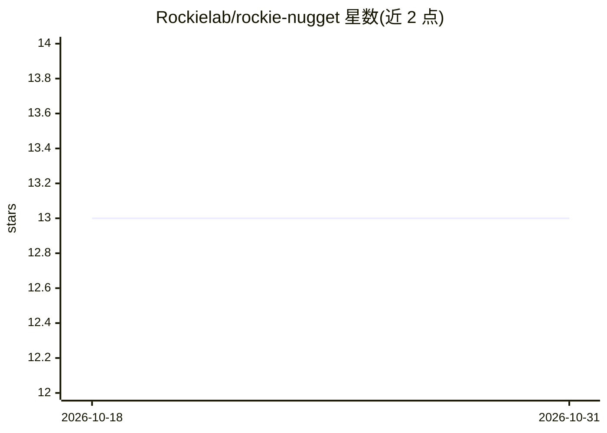

# Rockielab/rockie-nugget

⭐ 13 · Python · Apache-2.0 · 推送 2026-07-18 · [GitHub](https://github.com/Rockielab/rockie-nugget) · 组织维护

**面向长时程自主科研的模型无关 agent 运行时（基于 Goose）**

构建在 Goose 运行时之上的 config-only 科研 agent harness：通过 MCP 工具面（research-env-v1 动作空间：检索/写文件/沙箱命令/GPU 任务提交）让 agent 长时间无人值守地读文献、写代码、跑实验并迭代。模型无关，可指向任意 OpenAI 兼容端点（BYOK）。附带 ~300 个 markdown 技能目录、跨会话纯文本记忆、以及针对 RE-Bench/ScienceAgentBench/SUPER/MLE-bench 的评测适配器。安装脚本要求 Linux x86_64（glibc≥2.36）与 python3，下载 SHA 校验的 Goose 二进制。项目自声明为早期阶段，部分设计仍在落地。

## 筛选速览

| 维度 | 判定 | 备注 |
|---|---|---|
| AI 角色 | `ai-ecosystem` | LLM/agent 周边工具 |
| 许可风险 | `permissive` | Apache-2.0 |
| 部署形态 | `library` | 以包/库形式分发 |
| 模型依赖 | — | README 未给出锁定关系 |
| 硬件要求 | — | 无带数字的原话,不猜 |
| 安装摩擦 | `low` | 无编译、无系统依赖或容器化 |
| 成熟度 | `idea` | |

## 能力要点

- MCP 原生工具面 research-env-v1（Gather/Write/Run/Experiment/Finish 动作空间）
- 模型无关：任意 OpenAI 兼容端点 + BYOK，overlay 不绑定模型或厂商
- 3-file prepare/run/grade 评测适配器模式，支持 RE-Bench/ScienceAgentBench/SUPER/MLE-bench
- 纯文本跨会话记忆（[LEARN]/[DEAD-END] + Stop hook），无数据库

## 适用场景

- 让 AI agent 无人值守完成读论文、实现、跑 GPU 实验、读指标的完整科研循环
- 在统一 harness 内评测不同模型的科研能力
- 多天持续的科研 campaign（autoresearch.yaml sustained 模式）

## 场景标签

`科研工具` `模型评测` · 领域:评测与运维

## 证据(README 行号)

> L5: rockie-nugget is a thin, model-agnostic agent runtime built for one job: running an AI agent
> L23: - **MCP-native.** Tools are Model Context Protocol
> L117: rockie-nugget ships an **eval environment** so you can measure how well *any* model does

## 星数曲线

2026-10-18 13 → 2026-10-31 13（+0）

---
*卡片 v1 · prompt 1.4 · 生成 2026-10-31 · 置信度 high · 依据 README sha `702c64e58ef8` · [字段定义](../../DATASET.md)*
