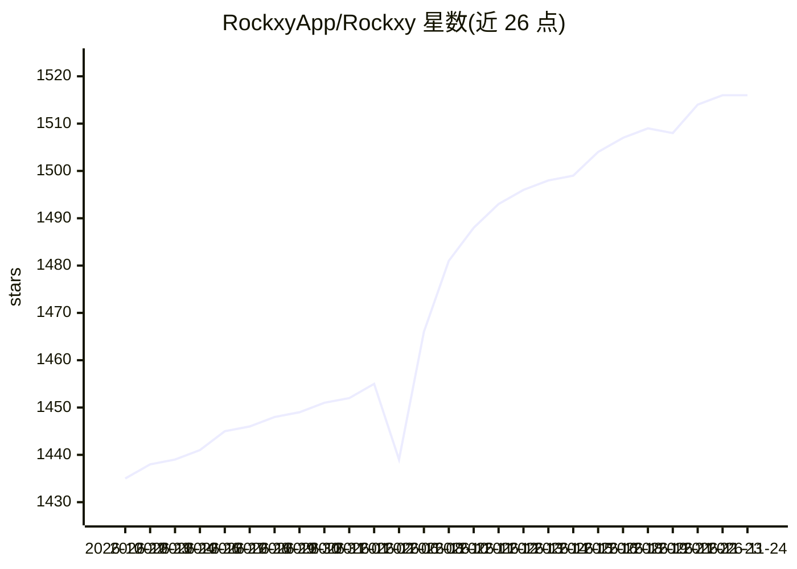

# RockxyApp/Rockxy

⭐ 1,519 · Swift · AGPL-3.0 · 推送 2026-11-21 · [GitHub](https://github.com/RockxyApp/Rockxy) · [官网](https://rockxy.io) · 组织维护

**macOS 原生 HTTP 调试代理：抓包、解密、Mock 与 AI 辅助分析**

用 Swift 编写的原生 macOS HTTP/HTTPS/WebSocket/GraphQL 调试代理，提供流量捕获、多字段过滤、按主机 TLS 解密、Map Local/Map Remote、断点改写、Block List 与证书管理等功能；AI 部分包括基于本地证据分析并可接 Ollama/配置模型的 AI Assistant，以及向 Claude Desktop/Cursor 等 MCP 客户端暴露只读工具的本地 MCP Server。社区源码版采用 AGPL-3.0，官方签名下载来自独立分发渠道，含付费 Pro 能力。

## 筛选速览

| 维度 | 判定 | 备注 |
|---|---|---|
| AI 角色 | `ai-enhanced` | 去掉 AI 部分产品仍成立 |
| 许可风险 | `viral` | AGPL-3.0 |
| 部署形态 | `None` |  |
| 模型依赖 | local-ok | 支持本地模型 |
| 硬件要求 | — | 无带数字的原话,不猜 |
| 安装摩擦 | `low` | 无编译、无系统依赖或容器化 |
| 成熟度 | — | 结构信号不足 |

## 能力要点

- 捕获并检查 HTTP/HTTPS/WebSocket/gRPC-Web/GraphQL 流量
- AI Assistant：本地证据分析，可选 Ollama 或配置的 provider 模型，读流量脱敏
- 本地 MCP Server 向 Claude Desktop/Cursor 等 MCP 客户端暴露只读工具
- Map Local/Map Remote、断点、Block List、按主机 TLS 解密与 P-256 根证书管理

## 适用场景

- 调试 Mac 应用、CLI 或 iOS 设备的 API 请求
- 拦截并检查 AI 模型调用与流式响应
- 通过 mock/断点/重定向模拟异常响应测试降级逻辑
- 把抓包数据交给 Claude Desktop 等客户端进行排查问答

## 场景标签

 · 领域:开发者工具/网络调试

## 证据(README 行号)

> L29:  Intercept, inspect, and modify HTTP/HTTPS/WebSocket/GraphQL traffic with a native Swift app you can inspect, build
> L144: Select one or more captured requests and ask what happened, what failed, what changed, or what to verify next. Roc
> L154: Let Claude Desktop, Claude Code, or another MCP client inspect captured traffic through ten read-only tools in Roc

## 星数曲线

2026-10-22 1,435 → 2026-11-24 1,516（+81）

---
*卡片 v1 · prompt 1.4 · 生成 2026-11-23 · 置信度 high · 依据 README sha `e8e2c51e91c8` · [字段定义](../../DATASET.md)*
