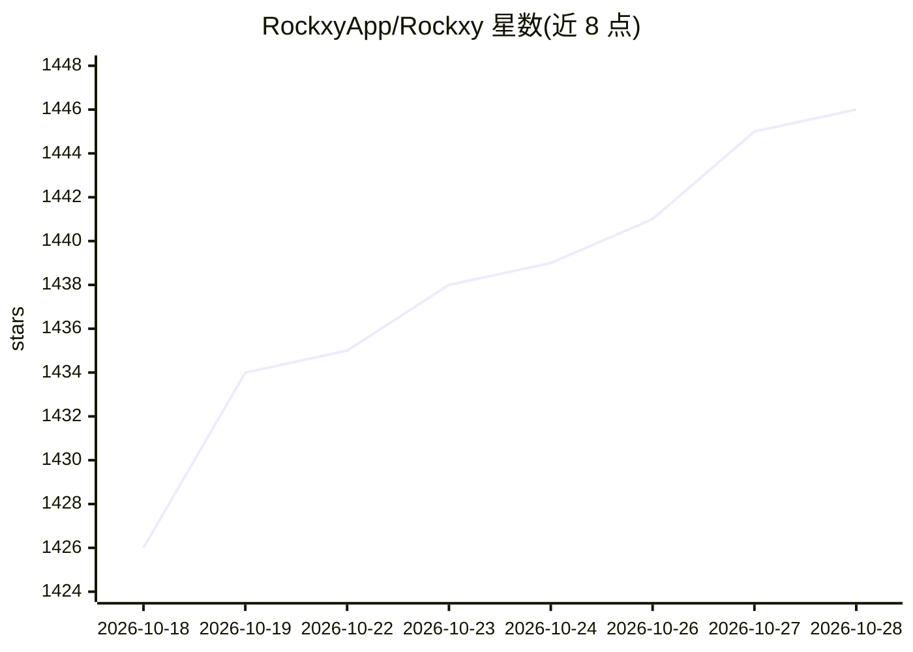

# RockxyApp/Rockxy

⭐ 1,448 · Swift · AGPL-3.0 · 推送 2026-10-20 · [GitHub](https://github.com/RockxyApp/Rockxy) · [官网](https://rockxy.io) · 组织维护 · 中文 README

**macOS 原生 HTTP/HTTPS 调试代理（AGPL 社区源码版）**

以 Swift 编写的 macOS 原生抓包调试代理，拦截、查看与修改 HTTP/HTTPS/WebSocket/GraphQL 流量，覆盖 iOS 设备与模拟器。功能含按主机 TLS 解密（Keychain 封存 P-256 根证书）、Map Local/Remote、断点与规则、Block List、上游代理、Traffic Insights 导出。AI 相关：内置本地分析的 AI Assistant（可选 Ollama 或配置的 provider 模型，Review Data 确认与脱敏）及向 Claude Desktop/Cursor 暴露 10 个只读工具的本地 MCP server。本仓库为 AGPL 社区源码版，需自行构建；官方签名 DMG 来自独立下游分发并可解锁付费 Pro。

## 筛选速览

| 维度 | 判定 | 备注 |
|---|---|---|
| AI 角色 | `ai-enhanced` | 去掉 AI 部分产品仍成立 |
| 许可风险 | `viral` | AGPL-3.0 |
| 部署形态 | `None` |  |
| 模型依赖 | local-ok | 支持本地模型 |
| 硬件要求 | — | 无带数字的原话,不猜 |
| 安装摩擦 | `low` | 无编译、无系统依赖或容器化 |
| 成熟度 | — | 结构信号不足 |

## 能力要点

- 拦截并检查 HTTP/HTTPS/WebSocket/GraphQL 流量，支持 iOS 设备
- AI Assistant 基于选中请求做本地分析，可选 Ollama/provider 模型，数据脱敏后送出
- 本地 MCP server 向 Claude Desktop/Cursor 暴露 10 个只读流量检查工具
- Map Local/Remote、Block List、按主机 TLS 解密与上游代理等功能

## 适用场景

- 调试浏览器之外的 Mac CLI、移动与后端 API 流量
- 把生产流量重定向到 staging 或本地文件复现问题
- 让 Claude Desktop/Cursor 直接检查抓包记录定位 500 错误

## 场景标签

 · 领域:网络调试/开发者工具

## 证据(README 行号)

> L29:  Intercept, inspect, and modify HTTP/HTTPS/WebSocket/GraphQL traffic with a native Swift app you can inspect, build
> L103: - AI Assistant now investigates one or more selected requests with built-in local analysis, optional Ollama or con
> L145: Select one or more captured requests and ask what happened, what failed, what changed, or what to verify next. Roc

## 星数曲线

2026-10-18 1,426 → 2026-10-28 1,446（+20）

---
*卡片 v1 · prompt 1.4 · 生成 2026-10-21 · 置信度 high · 依据 README sha `83e3e1671fcf` · [字段定义](../../DATASET.md)*
