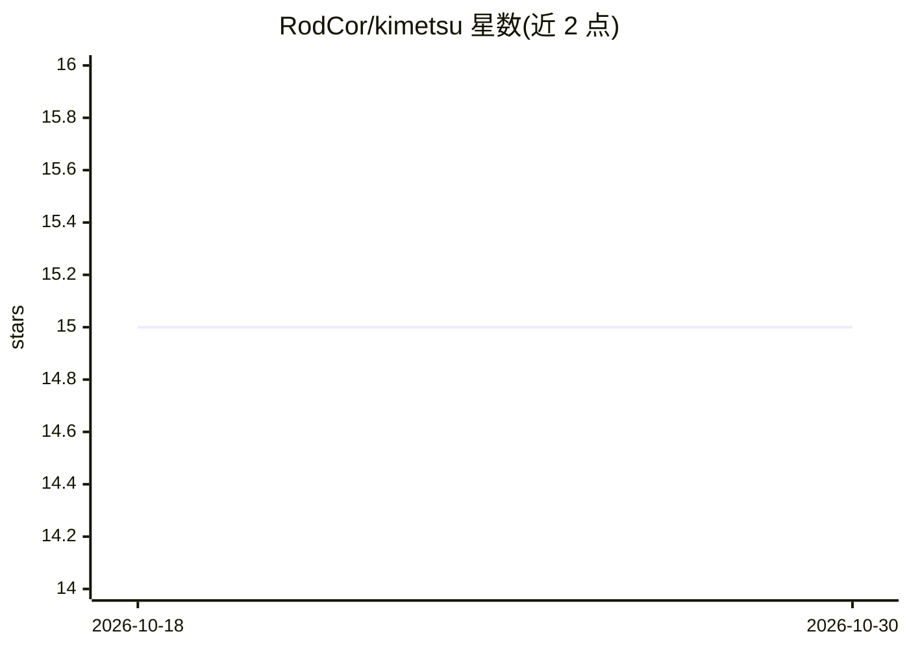

# RodCor/kimetsu

⭐ 15 · Rust · Apache-2.0 · 推送 2026-10-13 · [GitHub](https://github.com/RodCor/kimetsu) · 个人维护

**给编码 agent 配套的本地记忆边车：捕获并回注经验教训**

以单个 Rust 二进制加每项目一个 SQLite 文件的形式，为 Claude Code、Codex、Pi、OpenClaw、Cursor 等 agent 宿主提供记忆层，经 MCP 接入或自带终端聊天使用。默认记忆管线不做 LLM 调用：存储与检索基于 FTS5、本地 embedding 与本地 cross-encoder，可离线运行。任务前由 broker 打分注入上下文，任务后按引用情况提升或衰减记忆；支持导出/合并/同步记忆包及 HTTP MCP 团队共享（Kimetsu Remote，beta）。另有需 API key 的实验性 decision-provider 通道。

## 筛选速览

| 维度 | 判定 | 备注 |
|---|---|---|
| AI 角色 | `ai-ecosystem` | LLM/agent 周边工具 |
| 许可风险 | `permissive` | Apache-2.0 |
| 部署形态 | `library` | 以包/库形式分发 |
| 模型依赖 | local-ok | 支持本地模型 |
| 硬件要求 | — | 无带数字的原话,不猜 |
| 安装摩擦 | `low` | 无编译、无系统依赖或容器化 |
| 成熟度 | `idea` | |

## 能力要点

- 单个 Rust 二进制 + 每项目一个 SQLite 文件，经 MCP 接入多种 agent 宿主
- 默认记忆管线零 LLM 调用：FTS5 + 本地 embedding + 本地 cross-encoder，可离线
- 记忆按引用提升、按半衰期衰减，非平凡会话自动收获教训
- 记忆包导出自动脱敏（凭据/PII），支持合并与跨机同步

## 适用场景

- 让编码 agent 记住项目约定、失败模式与命令，跨会话复用
- 新成员或新机器通过导入记忆包快速获得团队经验
- 想为终端编码助手加本地记忆但不想引入云端服务的开发者

## 场景标签

`Agent 记忆` · 领域:Agent 开发

## 证据(README 行号)

> L21: Kimetsu is a sidecar brain for your agent. One Rust binary and one SQLite file
> L22: per project, wired into Claude Code, Codex, Pi, OpenClaw, or Cursor over MCP,

## 星数曲线

2026-10-18 15 → 2026-10-30 15（+0）

---
*卡片 v1 · prompt 1.4 · 生成 2026-10-30 · 置信度 high · 依据 README sha `8d3320a7707e` · [字段定义](../../DATASET.md)*
