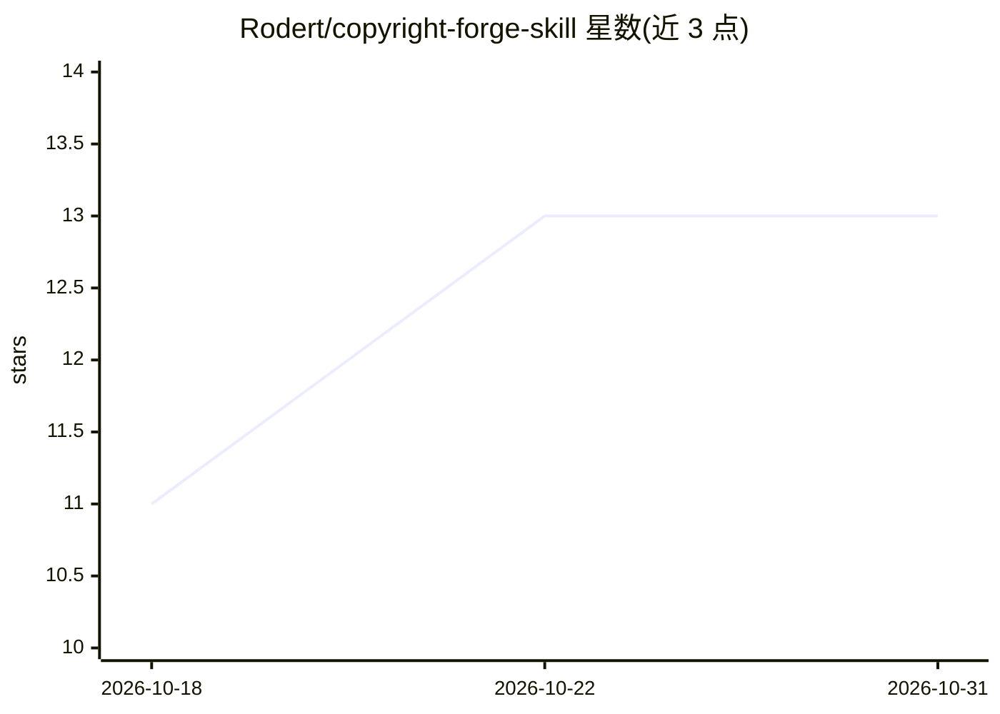

# Rodert/copyright-forge-skill

⭐ 13 · Python · Apache-2.0 · 推送 2026-09-02 · [GitHub](https://github.com/Rodert/copyright-forge-skill) · [官网](https://rodert.github.io/copyright-forge-skill/) · 个人维护 · 中文 README

**面向开发者的软著材料生成 Agent Skill**

以 SKILL.md 形式安装到 Claude Code、Codex、OpenCode 等 Agent 工具中的软件著作权材料生成技能：Agent 扫描真实代码项目，建立功能证据与证据映射，仅就代码无法确定的事实（权属、日期等）向用户确认，随后锁定事实源，生成说明书、源程序鉴别材料（HTML/DOCX/PDF）、申请信息指引、证据清单与质量报告，并通过八道质量门的独立审核。输出写入项目外独立目录，支持任务中断与断点恢复；不提交登记申请，不生成官方申请表。辅助脚本要求 Python 3.10+，PDF 渲染需 reportlab。

## 筛选速览

| 维度 | 判定 | 备注 |
|---|---|---|
| AI 角色 | `ai-native` | 本体是模型或模型工具 |
| 许可风险 | `permissive` | Apache-2.0 |
| 部署形态 | `None` |  |
| 模型依赖 | — | README 未给出锁定关系 |
| 硬件要求 | — | 无带数字的原话,不猜 |
| 安装摩擦 | `low` | 无编译、无系统依赖或容器化 |
| 成熟度 | — | 结构信号不足 |

## 能力要点

- 读取真实代码建立功能证据，无代码证据的功能不写入正式材料
- 八道质量门独立审核（事实、证据、一致性、源程序、说明书、隐私、幻觉、提交前）
- 工作流状态持久化（software-profile.yaml / evidence-map.json 等），支持中断续办
- 源程序材料从第一方核心代码选取、脱敏、分页，输出 HTML/DOCX/PDF

## 适用场景

- 把我的开源/私有项目整理成一套软著申请材料
- 对照版权中心补正意见修改已生成的材料
- 检查项目功能是否有足够代码证据支撑申请

## 场景标签

`AI 写作` · 领域:内容生成

## 证据(README 行号)

> L3: > 把真实软件项目变成可追溯、可检查、可继续修改的软著材料。
> L91: 4. 确认后锁定软件事实，生成说明书、源程序鉴别材料、申请信息填写指引、功能证据清单和质量报告。
> L92: 5. 源程序会从第一方核心代码中选择连续材料、进行脱敏、分页，并可输出 HTML、DOCX、PDF。

## 星数曲线

2026-10-18 11 → 2026-10-31 13（+2）

---
*卡片 v1 · prompt 1.4 · 生成 2026-10-31 · 置信度 high · 依据 README sha `8efe947448e4` · [字段定义](../../DATASET.md)*
