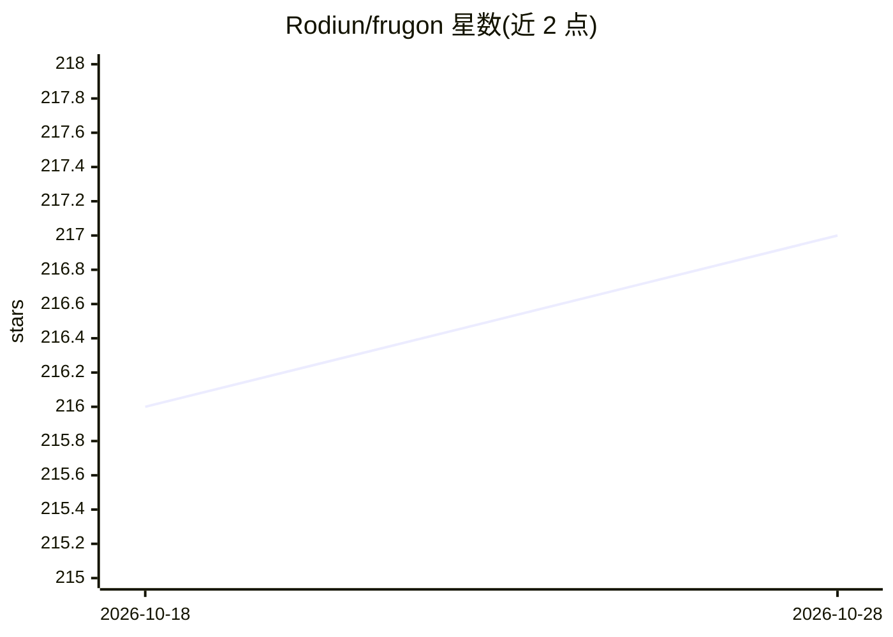

# Rodiun/frugon

⭐ 217 · Python · MIT · 推送 2026-10-19 · [GitHub](https://github.com/Rodiun/frugon) · [官网](https://frugon.rodiun.io) · 组织维护

**本地运行的 LLM 账单分析器：定位成本泄漏并给出路由建议**

读取 OpenAI 格式的 JSONL 调用日志，在本地用分词器+定价数据计算各模型下的成本，按易/难启发式拆分流量，输出"把 X% 调用路由到更便宜模型可省 ~$Y/月"的建议，可生成 HTML/Markdown 报告。通过本地 HTTP 代理 shim 捕获调用记录，或直接读取已有日志。可选 --measure/--judge 用用户自己的 key 抽样候选模型并做匿名两两评审，计算每成功答案的有效成本。面向 agent 开发者、AI 团队与独立开发者。限制：analyze 是离线估计而非实测，质量分层来自公开榜单先验，抽样可能漏掉尾部样本，无法计入下游二次成本。

## 筛选速览

| 维度 | 判定 | 备注 |
|---|---|---|
| AI 角色 | `ai-ecosystem` | LLM/agent 周边工具 |
| 许可风险 | `permissive` | MIT |
| 部署形态 | `library` | 以包/库形式分发 |
| 模型依赖 | — | README 未给出锁定关系 |
| 硬件要求 | — | 无带数字的原话,不猜 |
| 安装摩擦 | `low` | 无编译、无系统依赖或容器化 |
| 成熟度 | — | 结构信号不足 |

## 能力要点

- 全本地成本分析，无 LLM 调用、无网络上报
- 本地代理 shim 捕获调用生成 JSONL 日志
- 路由建议：按易/难拆分给出可省金额与质量取舍提示
- --measure/--judge 抽样实测与匿名两两评审，输出 Eff. $/success

## 适用场景

- 分析我的 LLM 调用日志，看哪些请求可换更便宜的模型
- 为预算评审生成可分享的节省报告
- 实测候选模型在我的真实提示上的质量是否达标

## 场景标签

`LLM 可观测性` · 领域:评测与运维

## 证据(README 行号)

> L79: - **Cost analysis** — fully local, no LLM calls, no network. Tokenizers + pricing + arithmetic on your machine.
> L81: - **Routing recommendation** — "move these X% of calls to a cheaper model and save ~$Y/mo; keep the hard Z% where t

## 星数曲线

2026-10-18 216 → 2026-10-28 217（+1）

---
*卡片 v1 · prompt 1.4 · 生成 2026-10-22 · 置信度 high · 依据 README sha `4d5943046e00` · [字段定义](../../DATASET.md)*
