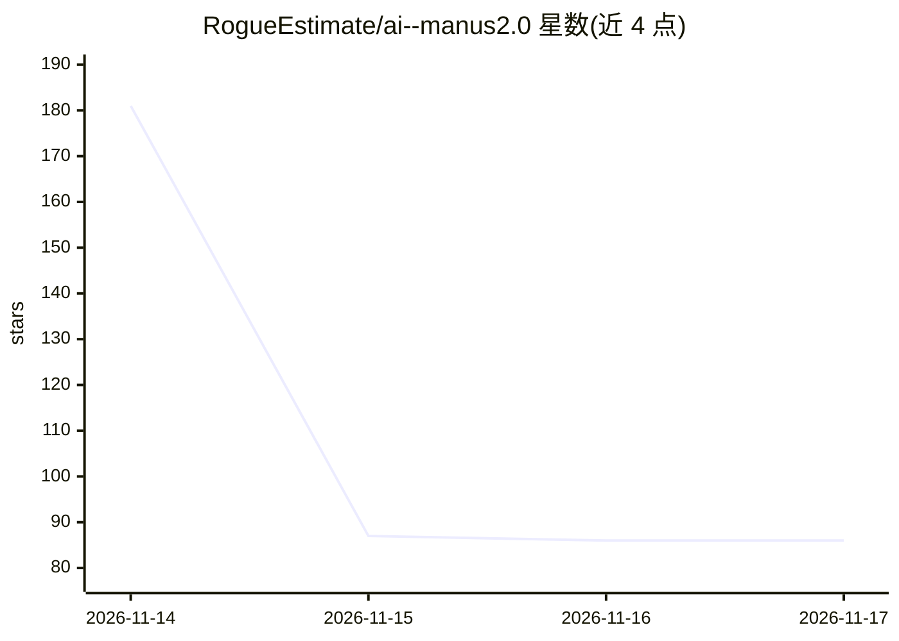

# RogueEstimate/ai--manus2.0

⭐ 86 · Apache-2.0 · 推送 2026-11-15 · [GitHub](https://github.com/RogueEstimate/ai--manus2.0) · 个人维护

**面向个人用户的自主 AI Agent：代跑代码与控制浏览器**

README 以功能介绍为主：Manus 自主 AI agent 可自行编写并执行脚本、控制浏览器（导航页面、填表、收集信息）、执行多步骤任务，定位为家庭、学习与轻量办公场景的个人助理，而非企业平台。内容覆盖能力说明、兼容性表（最低双核 CPU/4 GB 内存）、上手步骤与适用场景列表。README 未提供安装命令、代码入口或技术架构说明，功能描述为宣传口径，可验证细节有限。

## 筛选速览

| 维度 | 判定 | 备注 |
|---|---|---|
| AI 角色 | `ai-native` | 本体是模型或模型工具 |
| 许可风险 | `permissive` | Apache-2.0 |
| 部署形态 | `None` |  |
| 模型依赖 | — | README 未给出锁定关系 |
| 硬件要求 | — | 无带数字的原话,不猜 |
| 安装摩擦 | `low` | 无编译、无系统依赖或容器化 |
| 成熟度 | — | 结构信号不足 |

## 能力要点

- 自主执行代码：agent 自行编写并运行脚本完成任务
- 浏览器控制：导航网页、填写表单、采集信息
- 代码与浏览器动作可在同一流程内衔接，支持多步骤任务

## 适用场景

- 让 agent 代为执行网页查证、表单填写等重复性操作
- 学习与科研场景下整理资料、跑小脚本
- 轻量办公中汇总多页面信息、准备小型报告

## 场景标签

`AI 助手` `编码 Agent` `浏览器自动化` · 领域:效率与自动化

## 证据(README 行号)

> L18: Manus is an autonomous AI agent designed to run code and control a browser on your behalf. Instead of acting like a
> L10: - **Autonomous Code Execution:** Manus AI agent runs code on its own to complete tasks, so you can focus on decisio

## 星数曲线

2026-11-14 181 → 2026-11-17 86（-95）

---
*卡片 v1 · prompt 1.4 · 生成 2026-11-17 · 置信度 mid · 依据 README sha `25103b48adc2` · [字段定义](../../DATASET.md)*
