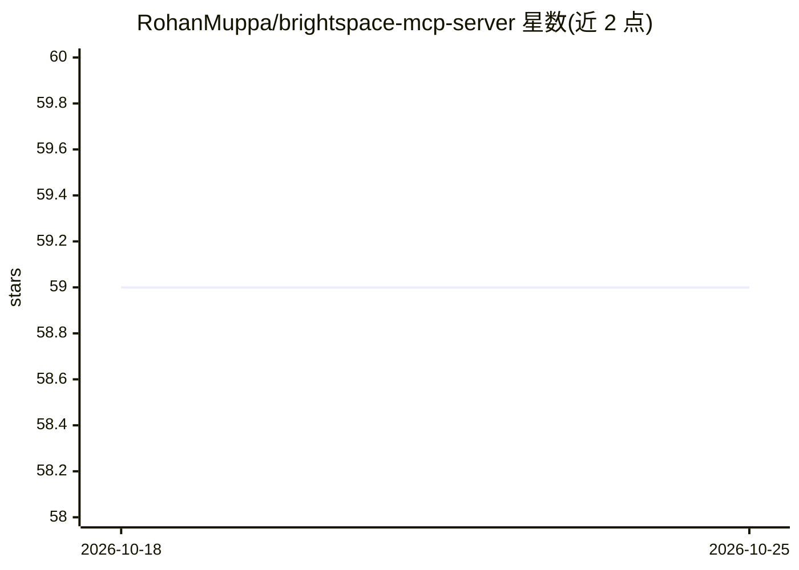

# RohanMuppa/brightspace-mcp-server

⭐ 59 · TypeScript · MIT · 推送 2026-10-25 · [GitHub](https://github.com/RohanMuppa/brightspace-mcp-server) · [官网](https://www.npmjs.com/package/brightspace-mcp-server) · 个人维护

**让学生/教师通过 AI 应用查看 Brightspace 课程数据的 MCP 服务器**

基于 Node.js 的 MCP 服务器，把 D2L Brightspace 的成绩、截止日期、作业、公告、名册、教学大纲、课程内容、测验、讨论与讲课录像等只读数据接入 Claude Desktop、ChatGPT Desktop、Cursor、Windsurf 等 MCP 客户端。通过浏览器登录完成各校 SSO/MFA 认证，密码存入系统钥匙串；支持 9 所学校的自动登录配置，其他 D2L 学校手动粘贴地址。提供 4 个内置提示词与单实例多会话 HTTP 模式。仅读取，不提交或修改任何内容。

## 筛选速览

| 维度 | 判定 | 备注 |
|---|---|---|
| AI 角色 | `ai-ecosystem` | LLM/agent 周边工具 |
| 许可风险 | `permissive` | MIT |
| 部署形态 | `library` | 以包/库形式分发 |
| 模型依赖 | — | README 未给出锁定关系 |
| 硬件要求 | — | 无带数字的原话,不猜 |
| 安装摩擦 | `low` | 无编译、无系统依赖或容器化 |
| 成熟度 | — | 结构信号不足 |

## 能力要点

- 只读访问 Brightspace 成绩/作业/公告/课程内容/测验/讨论/录像等数据
- 自动登录支持 9 所学校（Purdue、SUNY、TU Delft、McGill 等），其余 D2L 学校手动配置
- 密码存入系统钥匙串（Keychain/Credential Manager），支持 MFA/TOTP/会话 Cookie
- 单实例 HTTP 模式（token 保护）供多个 AI 会话共享，另有 4 个内置提示词

## 适用场景

- 问 AI '这周有什么作业要交'、'我所有课都及格吗'来查看课业
- 让 AI 汇总今日公告、生成每周简报或学习计划
- 把讲课幻灯片转成闪卡、从 Module 5 批量下载 PDF
- 教师/助教查看未交作业学生名单与已留反馈

## 场景标签

 · 领域:教育/学习管理系统接入

## 证据(README 行号)

> L15: Works with Claude Desktop, Claude Code, Cursor, ChatGPT Desktop, Windsurf, and any other app that supports MCP (the
> L43: Using a different AI app? Add the command `npx -y brightspace-mcp-server@latest` to its MCP settings (on Windows: `

## 星数曲线

2026-10-18 59 → 2026-10-25 59（+0）

---
*卡片 v1 · prompt 1.4 · 生成 2026-10-24 · 置信度 high · 依据 README sha `ea8a34fdbc86` · [字段定义](../../DATASET.md)*
