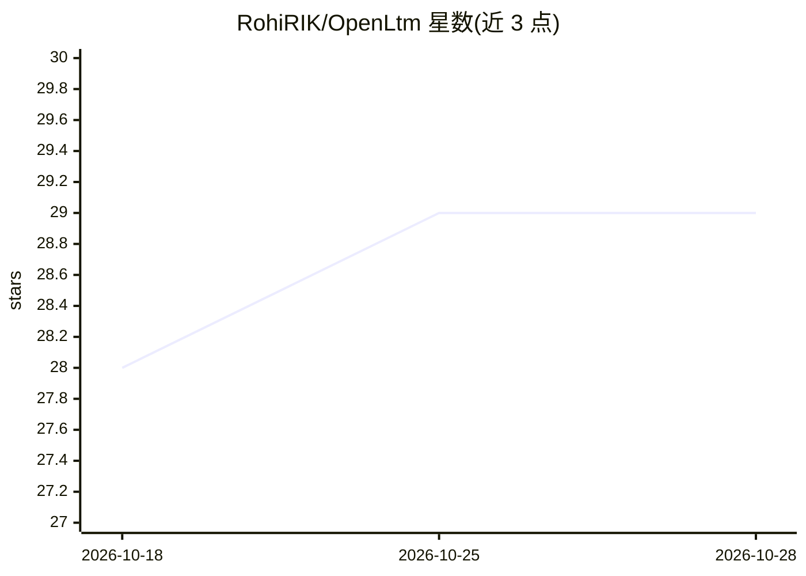

# RohiRIK/OpenLtm

⭐ 29 · TypeScript · MIT · 推送 2026-10-26 · [GitHub](https://github.com/RohiRIK/OpenLtm) · 个人维护

**给 AI 编程 agent 的长期记忆插件：跨会话语义记忆存取**

为 Claude Code、OpenCode、Pi、OpenClaw、Hermes 五类 host 提供持久语义记忆的插件：核心引擎为 npm 包 @rohirik/openltm-core，各 host 用适配器接入，共享同一个本地 SQLite 数据库。会话结束时 hook 提取模式并存储，会话开始时注入项目目标/决策/gotchas；检索采用 FTS5 全文与向量嵌入混合、Reciprocal Rank Fusion 融合；嵌入默认由本地 llama.cpp（bge-m3）提供，清理 LLM 默认本地 Ollama，云端为 opt-in；含衰减、去重建议、隐私过滤与秘密擦洗（部分写入路径未覆盖）。无遥测。

## 筛选速览

| 维度 | 判定 | 备注 |
|---|---|---|
| AI 角色 | `ai-ecosystem` | LLM/agent 周边工具 |
| 许可风险 | `permissive` | MIT |
| 部署形态 | `library` | 以包/库形式分发 |
| 模型依赖 | local-ok | 支持本地模型 |
| 硬件要求 | — | 无带数字的原话,不猜 |
| 安装摩擦 | `low` | 无编译、无系统依赖或容器化 |
| 成熟度 | — | 结构信号不足 |

## 能力要点

- FTS5+向量混合检索并以 RRF 融合，按项目/状态/隐私过滤
- 嵌入与 janitor LLM 默认本地（llama.cpp + bge-m3、Ollama），云端 opt-in
- 单 SQLite 文件、五类 host 适配器共享同一数据库
- 记忆按 importance×confidence 衰减，importance:5 永久保留

## 适用场景

- 跨会话保留项目的决策、偏好与 gotchas，无需重复解释
- 在 Claude Code 学到的记忆迁移到 OpenCode 等其他 host 复用
- 用脚本/CI 向记忆库写入或检索条目（headless CLI）

## 场景标签

`Agent 记忆` · 领域:Agent 开发

## 证据(README 行号)

> L7: **Long-Term Memory for AI coding agents** — Claude Code, OpenCode, Pi, OpenClaw, and Hermes
> L22: - **One engine, five hosts.** `@rohirik/openltm-core` holds the memory logic; each host gets a thin adapter (Hermes
> L67: - **Multi-host.** Claude Code, OpenCode, Pi, Hermes, OpenClaw, and others plug in through hooks and adapters over t

## 星数曲线

2026-10-18 28 → 2026-10-28 29（+1）

---
*卡片 v1 · prompt 1.4 · 生成 2026-10-26 · 置信度 high · 依据 README sha `8e0fa636b567` · [字段定义](../../DATASET.md)*
