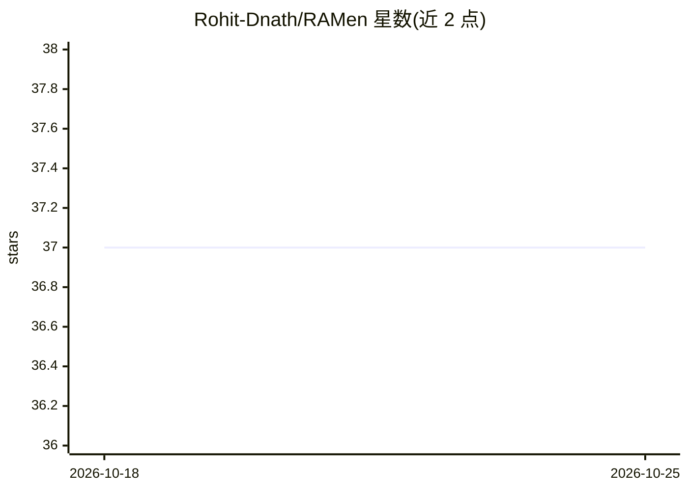

# Rohit-Dnath/RAMen

⭐ 37 · Go · BSD-3-Clause · 推送 2026-10-22 · [GitHub](https://github.com/Rohit-Dnath/RAMen) · 个人维护

**面向 AI 应用的内存数据存储：兼容 Redis 协议，带向量检索、语义缓存与 MCP 服务端**

用 Go 编写的单二进制内存键值存储，兼容 Redis 协议（RESP2），现有 Redis 客户端可直接连接。面向 AI 应用与 AI agent 提供三项能力：原生向量存取与检索（VSET/VSEARCH，无需 API key）、基于嵌入的语义缓存（相同含义的提示直接返回缓存答案，需配置嵌入服务，支持本地 Ollama 或 OpenAI）、内置 MCP 服务端让 Claude 等 agent 读写检索数据。附带实时仪表盘与 Prometheus 指标端点。限制：无集群/复制/故障转移，无 AOF 持久化（仅快照），单机场景。

## 筛选速览

| 维度 | 判定 | 备注 |
|---|---|---|
| AI 角色 | `ai-ecosystem` | LLM/agent 周边工具 |
| 许可风险 | `permissive` | BSD-3-Clause |
| 部署形态 | `self-host` | docker 或自建部署 |
| 模型依赖 | local-ok | 支持本地模型 |
| 硬件要求 | — | 无带数字的原话,不猜 |
| 安装摩擦 | `low` | 无编译、无系统依赖或容器化 |
| 成熟度 | — | 结构信号不足 |

## 能力要点

- 兼容 Redis 协议（RESP2），现有客户端与代码无需修改
- 内置向量检索与语义缓存（VSET/VSEARCH、SCACHE 命令）
- 内置 MCP 服务端，agent 可作为工具直接读写与记忆数据
- 单个 Go 二进制，附带实时仪表盘与 Prometheus 指标

## 适用场景

- 把现有使用 Redis 作缓存的应用直接切换过来
- 缓存语义相同的 AI 问答以减少模型调用花费
- 让 Claude 等 agent 通过 MCP 读写数据并跨轮次记忆

## 场景标签

`向量数据库` · 领域:知识与检索

## 证据(README 行号)

> L19: RAMen is a fast in-memory data store, like Redis, but built for AI apps and AI agents.
> L24: 2. It can store and search vectors, and it can cache AI answers by meaning. So if two prompts mean the same thing, 
> L25: 3. It has a built-in MCP server. That means AI agents (like Claude) can read, write, search, and remember data in R

## 星数曲线

2026-10-18 37 → 2026-10-25 37（+0）

---
*卡片 v1 · prompt 1.4 · 生成 2026-10-25 · 置信度 high · 依据 README sha `e286660dd708` · [字段定义](../../DATASET.md)*
