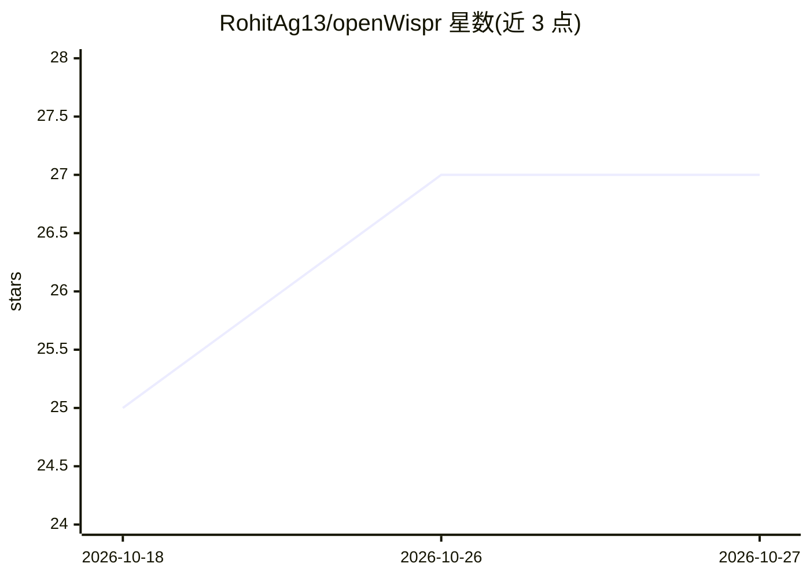

# RohitAg13/openWispr

⭐ 27 · C++ · MIT · 推送 2026-10-13 · [GitHub](https://github.com/RohitAg13/openWispr) · [官网](https://www.openwispr.dev) · 个人维护

**本地优先的语音听写应用：说话即转文字并插入当前输入框**

开源语音听写工具（Android 活跃、macOS Beta），管道为 mic→VAD→STT→个人词汇纠正→确定性清理→可选端上 LLM 润色→自动插入聚焦输入框。STT 默认用端上 whisper.cpp（macOS 可用 Apple Speech）或 OpenAI 兼容云端端点；润色用小型本地模型（llama.cpp 运行 GGUF）或云端。默认配置下数据不离开设备，仅首次从 Hugging Face 下载模型。自带微调的 Qwen3-0.6B 清理模型（GGUF）。安装方式为 Releases 页下载 APK/DMG，也可从源码构建。

## 筛选速览

| 维度 | 判定 | 备注 |
|---|---|---|
| AI 角色 | `ai-native` | 本体是模型或模型工具 |
| 许可风险 | `permissive` | MIT |
| 部署形态 | `desktop` | 安装包/桌面程序 |
| 模型依赖 | local-ok | 支持本地模型 |
| 硬件要求 | — | 无带数字的原话,不猜 |
| 安装摩擦 | `high` | 编译与系统依赖俱全 |
| 成熟度 | `idea` | |

## 能力要点

- 全管道可端上运行，本地模式下音频与文本不离设备
- 确定性清理层零延迟去填充词、规范化数字、解决自我纠正
- 用户纠正数据沉淀为个人词典与 STT 偏置，历史编辑作 few-shot 示例
- 微调的 Qwen3-0.6B 清理模型以 GGUF 发布在 Hugging Face

## 适用场景

- 在任何应用中用语音输入并自动插入光标处文字
- 在隐私敏感场景使用纯本地语音转文字
- 让听写结果学习自己的词汇和书写风格

## 场景标签

`语音识别` · 领域:感知与多模态

## 证据(README 行号)

> L97: mic → VAD → STT → personal-vocab correction → deterministic cleanup
> L101: - **STT** — speech-to-text via on-device **whisper.cpp** (or Apple Speech on macOS), or an

## 星数曲线

2026-10-18 25 → 2026-10-27 27（+2）

---
*卡片 v1 · prompt 1.4 · 生成 2026-10-26 · 置信度 high · 依据 README sha `37ae487865f3` · [字段定义](../../DATASET.md)*
