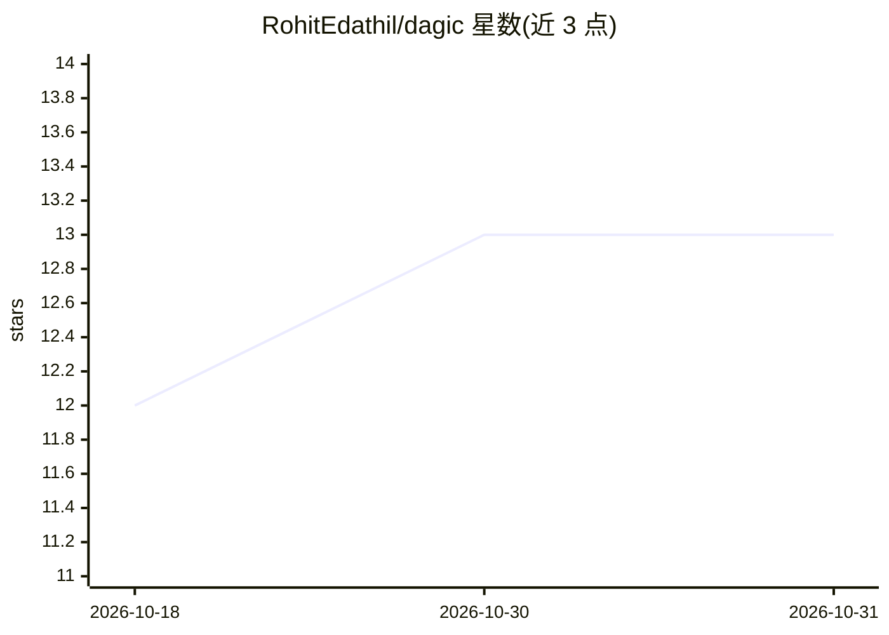

# RohitEdathil/dagic

⭐ 13 · Python · MIT · 推送 2026-10-19 · [GitHub](https://github.com/RohitEdathil/dagic) · 个人维护

**让 LLM 用微型 DSL 组合工具为类型化 DAG 并发执行的引擎**

面向 LLM agent 开发者的 Python 工作流语言与异步执行引擎：模型编写仅含赋值与函数调用的短程序，宿主解析、静态类型检查后构建 DAG 并发执行，只允许调用宿主注册的函数，避免沙箱执行任意生成代码。执行流为解析→类型检查→建图→从终端节点反向解析依赖并发执行。工具是带完整类型注解的普通 Python 函数，需 Python 3.10+，附带 float_math 内置模块。README 附两个实验（数学 agent、网页抓取 agent）对比逐次工具调用方式的 token 与延迟数据。

## 筛选速览

| 维度 | 判定 | 备注 |
|---|---|---|
| AI 角色 | `ai-ecosystem` | LLM/agent 周边工具 |
| 许可风险 | `permissive` | MIT |
| 部署形态 | `library` | 以包/库形式分发 |
| 模型依赖 | — | README 未给出锁定关系 |
| 硬件要求 | — | 无带数字的原话,不猜 |
| 安装摩擦 | `low` | 无编译、无系统依赖或容器化 |
| 成熟度 | — | 结构信号不足 |

## 能力要点

- 模型编写短程序，宿主类型检查后构建 DAG 并发执行独立分支
- 仅可调用宿主注册函数，不执行任意生成代码
- 编译期静态类型检查（含 List 泛型区分）
- 基于 asyncio 的异步执行，附带 float_math 内置模块

## 适用场景

- 让 agent 一次表达多步工具链，减少模型往返轮次
- 在无沙箱环境的主机上让 LLM 组合可信工具完成多步任务
- 需要编译期类型校验的工具编排场景

## 场景标签

`Agent 框架` · 领域:Agent 开发

## 证据(README 行号)

> L5: Dagic is a tiny workflow language and an async execution engine that lets an LLM
> L52: Dagic parses it, type-checks it, builds the DAG, and executes it — independent

## 星数曲线

2026-10-18 12 → 2026-10-31 13（+1）

---
*卡片 v1 · prompt 1.4 · 生成 2026-10-31 · 置信度 high · 依据 README sha `833fef264b5f` · [字段定义](../../DATASET.md)*
