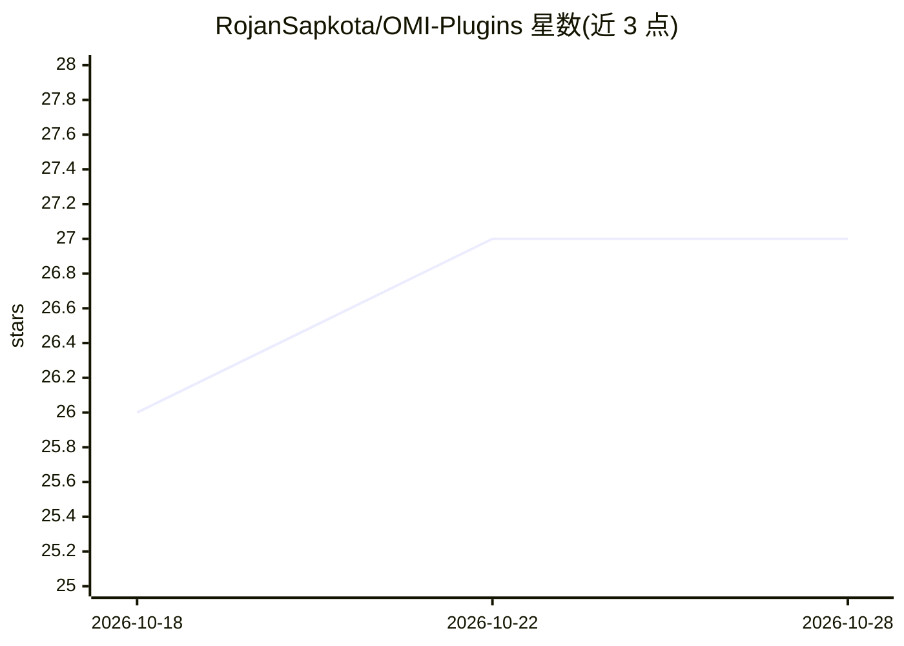

# RojanSapkota/OMI-Plugins

⭐ 27 · Python · MIT · 推送 2026-08-31 · [GitHub](https://github.com/RojanSapkota/OMI-Plugins) · [官网](https://omi.me) · 个人维护

**Omi AI 可穿戴设备的社区插件集**

为 Omi AI 可穿戴设备（项链形态的开放硬件）提供社区插件。Omi 通过蓝牙连接手机 App，采集对话并生成实时转录、会议摘要与行动项。README 说明插件通过 Omi App 的 Create an App 流程以 webhook 方式接入：创建 webhook URL、选择能力、安装后即可接收实时转录数据。仓库以 Python 为主，文档链接覆盖设备购买、固件安装与自建插件指南，MIT 许可。

## 筛选速览

| 维度 | 判定 | 备注 |
|---|---|---|
| AI 角色 | `ai-ecosystem` | LLM/agent 周边工具 |
| 许可风险 | `permissive` | MIT |
| 部署形态 | `None` |  |
| 模型依赖 | — | README 未给出锁定关系 |
| 硬件要求 | — | 无带数字的原话,不猜 |
| 安装摩擦 | `low` | 无编译、无系统依赖或容器化 |
| 成熟度 | — | 结构信号不足 |

## 能力要点

- 以 webhook 方式接入 Omi App，接收实时转录数据
- 覆盖 Omi App 安装、固件烧录、自建插件等文档入口
- MIT 许可，含 Discord 社区与插件共建指引

## 适用场景

- 为 Omi 可穿戴设备开发自定义插件/集成
- 通过 webhook 实时获取设备采集的对话转录
- 了解 Omi 设备的购买、组装与固件流程

## 场景标签

`语音识别` · 领域:感知与多模态

## 证据(README 行号)

> L3: Meet Omi, the world’s leading open-source AI wearable that captures conversations, gives summaries, action items and
> L25: |Explore => Create an App|Select Capability|Paste Webhook URL|Install App|

## 星数曲线

2026-10-18 26 → 2026-10-28 27（+1）

---
*卡片 v1 · prompt 1.4 · 生成 2026-10-26 · 置信度 mid · 依据 README sha `99a6b4167a2e` · [字段定义](../../DATASET.md)*
