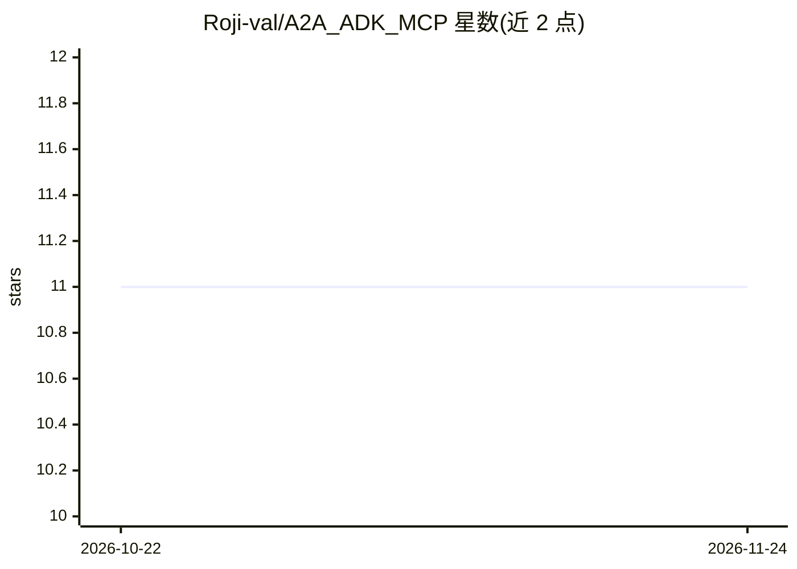

# Roji-val/A2A_ADK_MCP

⭐ 11 · Python · Apache-2.0 · 推送 2026-02-19 · [GitHub](https://github.com/Roji-val/A2A_ADK_MCP) · 个人维护

**用 Google ADK、A2A 与 MCP 构建多智能体系统的开发项目**

该仓库提供基于 Google Agent Development Kit（ADK）结合 A2A 通信协议与 MCP 的多智能体系统构建环境，宣称支持代理的便捷集成、可扩展架构、实时通信与自定义代理。README 给出 git clone、pip 依赖安装与 Releases 下载的安装步骤，并附创建与运行代理的 Python 示例代码；项目以 Python 实现，采用 MIT 许可证发布。

## 筛选速览

| 维度 | 判定 | 备注 |
|---|---|---|
| AI 角色 | `ai-ecosystem` | LLM/agent 周边工具 |
| 许可风险 | `permissive` | Apache-2.0 |
| 部署形态 | `library` | 以包/库形式分发 |
| 模型依赖 | — | README 未给出锁定关系 |
| 硬件要求 | — | 无带数字的原话,不猜 |
| 安装摩擦 | `low` | 无编译、无系统依赖或容器化 |
| 成熟度 | — | 结构信号不足 |

## 能力要点

- 基于 Google ADK 结合 A2A 与 MCP 构建多智能体系统
- 支持代理间实时通信与自定义代理
- 提供 Python 示例代码展示代理的创建与运行
- 采用 MIT 许可证开源

## 适用场景

- 搭建多个代理协作的多智能体系统
- 让代理之间通过 A2A 协议相互通信
- 基于 ADK 框架开发自定义代理应用

## 场景标签

`Agent 框架` `多智能体` · 领域:Agent 开发

## 证据(README 行号)

> L8: Welcome to the **A2A_ADK_MCP** repository! This project focuses on building **Multi-Agent Systems** using Google's *
> L14: In the era of advanced technology, multi-agent systems (MAS) play a crucial role in developing intelligent applicat

## 星数曲线

2026-10-22 11 → 2026-11-24 11（+0）

---
*卡片 v1 · prompt 1.4 · 生成 2026-11-18 · 置信度 mid · 依据 README sha `12ee732b1838` · [字段定义](../../DATASET.md)*
