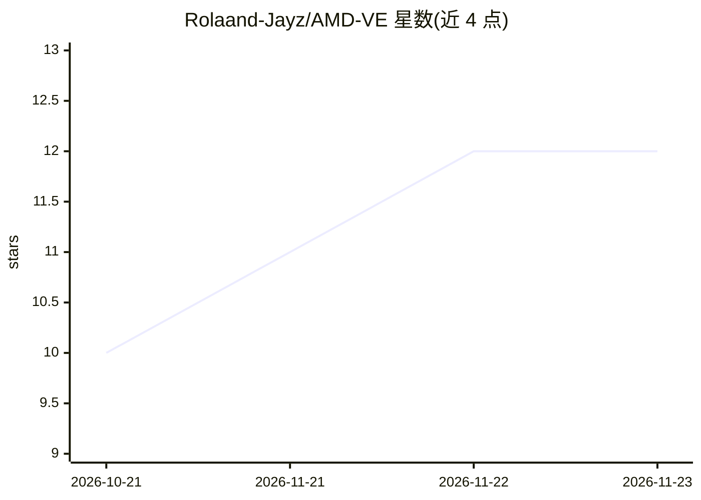

# Rolaand-Jayz/AMD-VE

⭐ 12 · C++ · MIT · 推送 2026-11-20 · [GitHub](https://github.com/Rolaand-Jayz/AMD-VE) · 个人维护

**面向 AMD GPU 的 Linux AI 视频修复与超分应用**

基于 C++20 的视频增强应用，通过 ROCm/MiGraphX/HIP/Vulkan 与 FFmpeg 管线在 AMD GPU 上对视频做修复、去噪与放大，提供 CLI 与可选 Qt GUI。后端按 MiGraphX → ONNX Runtime → Vulkan Compute → NCNN → FFmpeg 顺序自动选择。项目同时记录了对 MiGraphX 的 GPU 优化工作并提交至上游。验证环境限定于单一参考系统，作者声明为实验性 beta，不作为生产就绪软件提供。

## 筛选速览

| 维度 | 判定 | 备注 |
|---|---|---|
| AI 角色 | `ai-native` | 本体是模型或模型工具 |
| 许可风险 | `permissive` | MIT |
| 部署形态 | `desktop` | 安装包/桌面程序 |
| 模型依赖 | — | README 未给出锁定关系 |
| 硬件要求 | — | 无带数字的原话,不猜 |
| 安装摩擦 | `high` | 编译与系统依赖俱全 |
| 成熟度 | `idea` | |

## 能力要点

- MiGraphX 优先的多后端推理路径，含三条回退后端
- 内置模型管理器：下载、编译、校验并复用模型工件
- 确定性管线规划器负责阶段排序
- 打包为 portable bundle 与原生 Linux 包

## 适用场景

- 修复老录像的模糊、噪点与压缩损伤
- 对低分辨率素材进行放大处理
- 在 AMD GPU 上运行 AI 视频增强而不用 CUDA

## 场景标签

`图像视频处理` · 领域:感知与多模态

## 证据(README 行号)

> L5: AMD-VE is a native C++ video-enhancement application for AMD GPUs. It combines ROCm, MiGraphX, HIP, Vulkan, and FFmp
> L31: AMD Video Enhancer is a Linux-first video enhancer that uses ML and AI models to restore, clean, and upscale footag
> L109: - a **MiGraphX-first** inference path

## 星数曲线

2026-10-21 10 → 2026-11-23 12（+2）

---
*卡片 v1 · prompt 1.4 · 生成 2026-11-20 · 置信度 high · 依据 README sha `fadad6bf506e` · [字段定义](../../DATASET.md)*
