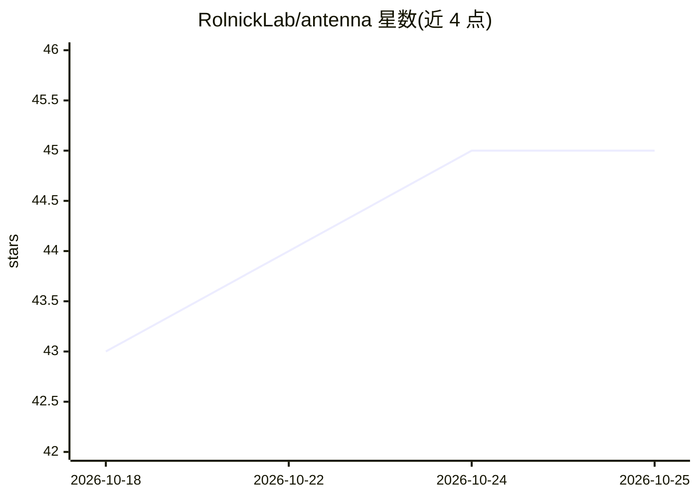

# RolnickLab/antenna

⭐ 45 · Python · AGPL-3.0 · 推送 2026-10-23 · [GitHub](https://github.com/RolnickLab/antenna) · [官网](https://insectai.org) · 组织维护

**昆虫相机陷阱图像的数据管理与 ML 流水线编排平台**

面向自动化昆虫监测站产生的图像，提供多部署项目协作、元数据管理与机器学习流水线编排的在线平台。后端基于 Django + Celery + PostgreSQL + NATS，前端为独立 Web UI，通过 Docker Compose 一键运行全部服务；ML 后端以 FastAPI 包装的 processing services 形式接入，example 应用演示如何添加新流水线、算法与模型。图像数据存储在项目自有的外部 S3 兼容对象存储（本地可用 Minio 模拟）。主要面向科研与保护领域的多部署图像数据项目。

## 筛选速览

| 维度 | 判定 | 备注 |
|---|---|---|
| AI 角色 | `ai-ecosystem` | LLM/agent 周边工具 |
| 许可风险 | `viral` | AGPL-3.0 |
| 部署形态 | `self-host` | docker 或自建部署 |
| 模型依赖 | — | README 未给出锁定关系 |
| 硬件要求 | — | 无带数字的原话,不猜 |
| 安装摩擦 | `low` | 无编译、无系统依赖或容器化 |
| 成熟度 | — | 结构信号不足 |

## 能力要点

- 多部署项目协作与元数据维护
- 可插拔的 ML processing services（FastAPI 响应 schema 包装检测结果）
- S3 兼容外部对象存储索引与处理（本地 Minio）
- Docker Compose 一键运行全栈（Web UI/API/数据库/消息队列）

## 适用场景

- 昆虫相机陷阱监测项目集中管理图像与元数据
- 编排多个机器学习流水线处理采集图像
- 科研团队协作维护跨部署的数据与检测结果

## 场景标签

`科研工具` `MLOps` `目标检测` · 领域:学习与行业

## 证据(README 行号)

> L3: Platform for processing and reviewing images from automated insect monitoring stations. Intended for collaborating o
> L44: 4) Optionally, run additional ML processing services: `processing_services` defines ML backends which wrap detectio

## 星数曲线

2026-10-18 43 → 2026-10-25 45（+2）

---
*卡片 v1 · prompt 1.4 · 生成 2026-10-25 · 置信度 low · 依据 README sha `949a419d3d91` · [字段定义](../../DATASET.md)*
