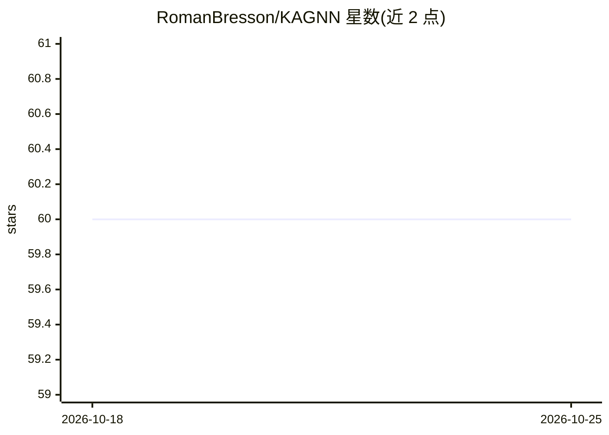

# RomanBresson/KAGNN

⭐ 60 · Python · 推送 2025-11-18 · [GitHub](https://github.com/RomanBresson/KAGNN) · 个人维护

**论文官方仓库：用 KAN 构建模块的图神经网络**

论文《KAGNNs: Kolmogorov-Arnold Networks meet Graph Learning》的官方代码库。提供将 Kolmogorov-Arnold Networks 用作图神经网络构建模块的模型实现，代码按学习任务划分（节点分类、图分类、图回归），并附带脚本用于复现实验。实验基于 python>=3.11 运行，KAN 部分采用 efficient-kan 实现。README 仅包含引用信息与运行说明，未提供安装命令。

## 筛选速览

| 维度 | 判定 | 备注 |
|---|---|---|
| AI 角色 | `ai-native` | 本体是模型或模型工具 |
| 许可风险 | `none` | — |
| 部署形态 | `None` |  |
| 模型依赖 | — | README 未给出锁定关系 |
| 硬件要求 | — | 无带数字的原话,不猜 |
| 安装摩擦 | `low` | 无编译、无系统依赖或容器化 |
| 成熟度 | — | 结构信号不足 |

## 能力要点

- KAN 作为图神经网络构建块的模型实现
- 按节点分类/图分类/图回归三类任务组织代码
- 提供实验复现脚本

## 适用场景

- 复现论文中的图学习实验
- 在图分类、图回归任务上研究 KAN-based 模型

## 场景标签

 · 领域:机器学习/图学习

## 证据(README 行号)

> L1: # KAGNNs -- Graph Neural Networks that use Kolmogorov Arnold Networks as their building blocks
> L7: The code is split by learning task (among node classification, graph classification, graph regression). Scripts are 

## 星数曲线

2026-10-18 60 → 2026-10-25 60（+0）

---
*卡片 v1 · prompt 1.4 · 生成 2026-10-24 · 置信度 high · 依据 README sha `d644234b5abe` · [字段定义](../../DATASET.md)*
